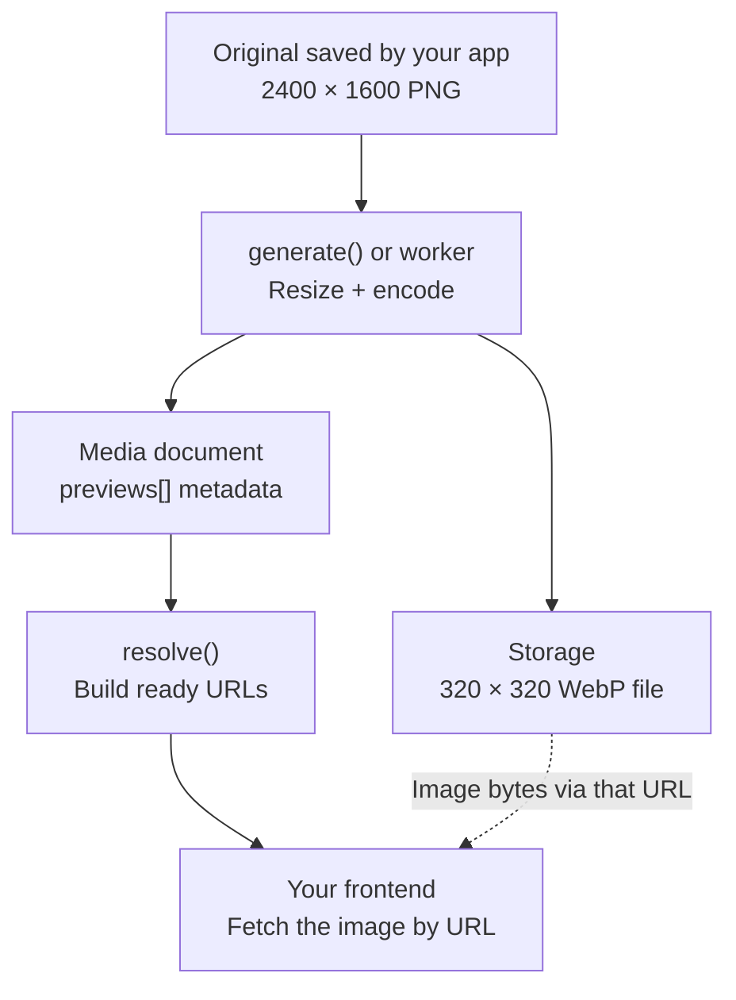
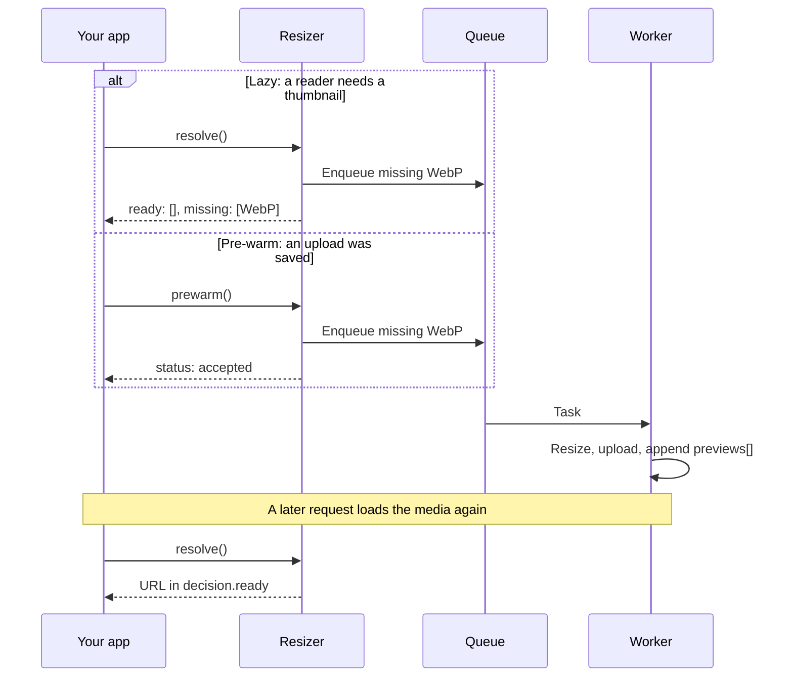

# Image Resizing

`@adaptivestone/framework-module-resize` makes resized copies of uploaded images. You store the uploaded **original** once. The module then creates **previews**, such as a `320×320` thumbnail and a `620`-pixel-wide detail image, with [`sharp`](https://sharp.pixelplumbing.com), stores them, and records them on your media document. When you build a response, it turns that record into image URLs.

- **Original**: the uploaded file, stored unchanged and privately.
- **Preview**: a generated image file. Its metadata is stored in the media document's `previews[]`.
- **Variant**: one requested size and format, plus optional filters. One size in JPEG, WebP and AVIF is three variants, and so three files.

The module handles resizing, storage calls and deciding which URLs are ready. Your app handles the upload endpoint, the media model, access checks, the response shape and deleting files.

<div className="resize-diagram" role="region" aria-label="From an uploaded original to a displayable preview" tabIndex={0}>



</div>

## Choose a workflow

| You want… | Call | The call waits for… | It returns |
|---|---|---|---|
| Previews ready when the upload request finishes | `generate()`: **eager** | resizing, upload and saving | `{ created, failed }` |
| A fast upload, with previews made in the background | `prewarm()`: **pre-warm** | queueing and its confirmation | `{ status, … }` per variant |
| Previews only for the sizes readers actually request | `resolve()` with a queue: **lazy** | queueing of the missing variants | `{ decision, output }` |

Every workflow reads URLs with `resolve()` and writes the same `previews[]`. You can mix them, for example pre-warm thumbnails and let detail sizes generate lazily. You can also switch later without migrating data. Start with eager, and add the [queue](#background) when uploads must stay fast.

## Set up

### 1. Install and scaffold

You need Node `>=24`, `@adaptivestone/framework` `^5.1.0`, and `mongoose` 9 (already in a framework app). From your app's root:

```bash
npm i @adaptivestone/framework-module-resize
npm exec --package=@adaptivestone/framework-module-resize -- resize-scaffold --eager
```

`resize-scaffold` ships with the package.

- `--eager` creates `src/resizer.ts` and `src/config/resize.ts`. Without it, the command also creates the queue model and the worker command (see [background generation](#background)).
- It never overwrites existing files; `--force` does.
- It adds a pointer to the package's agent guide to your `AGENTS.md`. Use `--agents claude|print|skip` to change that.
- In CI, run `resize-scaffold --check` (`--check --eager` for eager apps). It fails when a generated file is missing or has been changed in a way that breaks it.

### 2. Add the fields to your media model

```ts
// src/models/File.ts
import { BaseModel } from '@adaptivestone/framework/modules/BaseModel.js';
import { resizeMediaSchemaFragment } from '@adaptivestone/framework-module-resize/framework.js';

export default class File extends BaseModel {
  static get modelSchema() {
    return { name: { type: String }, ...resizeMediaSchemaFragment } as const;
  }
}
```

The fragment adds:
- `original`: where the original is stored, plus its format, size and dimensions.
- `previews[]`: one entry per generated file. Besides its URL fields, each entry records `bytes`, `createdAt`, `origin` (which original it was made from) and `encodeSig` (what it was encoded with: its format's encode settings, the sharpen setting of its fit mode, its animation settings (for animated formats: `animated`, `limits.animationFrames` and the pixel budget `min(limits.sourcePixels, limits.inputPixels)`, which also caps the frames at the larger of the source's and the preview's size), the result-dimension cap, the fit box (for fit rows) and the pipeline `version`). Its `identity` field lets the media store keep one entry per preview. A hand-written schema that declares preview entries as strict sub-documents needs `identity`, `origin` and `encodeSig` in them, each `{ type: String }`; `verify()` reports `RESIZE_MONGO_MEDIA_MODEL_OUTDATED` without them.

Keep Mongoose's `minimize: false`, which is the `BaseModel` default, because storage locators can contain empty objects. Save the media document before you generate previews; the module never creates it.

### 3. Configure

```ts
// src/config/resize.ts
import {
  defaultFrameworkResizeConfig,
  type FrameworkResizeConfig,
} from '@adaptivestone/framework-module-resize/framework.js';

export default {
  ...defaultFrameworkResizeConfig,
  mediaModelName: 'File', // your media model
  storage: { driver: 'local', rootDir: './var/media', publicBaseUrl: '/media' },
} satisfies FrameworkResizeConfig;
```

The module merges the image settings over the package defaults, so a key you leave out keeps its default; spreading the defaults, as the scaffold does, keeps them visible in the file. It then validates the result and throws `ResizeConfigError` if anything is wrong. Put environment-specific changes in `resize.production.ts` and similar files; the framework merges them. For example, S3 in production only:

```ts
// src/config/resize.production.ts
import type { FrameworkResizeConfig } from '@adaptivestone/framework-module-resize/framework.js';

export default {
  storage: {
    driver: 's3',
    bucketPublic: 'my-cdn',
    bucketPrivate: 'my-originals',
    publicBaseUrl: 'https://cdn.example.com',
  },
} satisfies Partial<FrameworkResizeConfig>;
```

An override that changes only nested keys, such as `limits: { sourcePixels: 20_000_000 }`, writes `satisfies PartialFrameworkResizeConfig` (from `…/framework.js`) instead. All options are listed under [configuration](#configuration).

### 4. Create the Resizer

```ts
// src/resizer.ts
import { FrameworkResizer } from '@adaptivestone/framework-module-resize/framework.js';

export const resizer = new FrameworkResizer({ pipelines: { default: {} } });
```

`FrameworkResizer` builds everything else from `src/config/resize.ts`: the image settings, the storage, the task queue, the media store (`FrameworkMediaStore`, over your media model `mediaModelName`), for a queue that cannot gate by itself, such as SQS, the lock store (`FrameworkLockStore`, the framework's `Lock` model; the database queue needs none), and the app logger. So `src/resizer.ts` holds only behaviour: pipelines and hooks. Options win over the config; for example, `new FrameworkResizer({ storage: new S3Storage({ …, client }) })` reuses your own S3 client. Import `src/resizer.ts` wherever you need the Resizer; a normal static import is fine, because nothing is read from the framework until first use. Elsewhere in your code, `getResizer()` returns the same instance.

A config mistake then shows up at the first upload or read. To catch it at startup instead, verify after initialization:

```ts
// src/server.ts
await server.init();
await resizer.verify(); // config, storage, the media model, the task queue (ResizeTask model, its gate index, and the queue), and the Lock model when its queue is on SQS
await server.startServer();
```

`LocalFsStorage` writes:
- previews under `rootDir`;
- private originals under `privateRootDir`, which defaults to `./var/media-private`.

Serve only `rootDir`, at `/media`; never serve the private folder. For S3, see [drivers](#drivers).

### 5. Store the original at upload

```ts
import { getResizer } from '@adaptivestone/framework-module-resize';

fileDoc.original = await getResizer().uploadOriginal({
  body: buffer, // the uploaded bytes
  visibility: 'private',
  // namespace: `users/${user.id}`, // optional key prefix; not access control
});
await fileDoc.save();
```

`uploadOriginal()` detects the format and dimensions with its decoders (Sharp for raster images and SVG), then stores the bytes unchanged under a random name. It returns the value to save as `original`. It does not create the document or queue any work. Input larger than `upload.maxBytes` (25 MiB by default), or in a format not listed in `upload.formats`, throws `ResizeOriginalError`.

Save `original` exactly as returned. Its `storageRef` is the storage driver's own locator: `{ path, visibility }` for local files, `{ bucket, key }` for S3. Never build it by hand.

## Sizes and formats

Define a fixed catalog of sizes for each use, and pass the same catalog when you generate and when you read:

```ts
// src/mediaSizes.ts
import type { PreviewFormat, SizeInput } from '@adaptivestone/framework-module-resize';

export const thumbnailSizes: SizeInput[] = [{ width: 320, height: 320 }];
export const detailSizes: SizeInput[] = [{ width: 620 }, { fit: true }];
export const previewFormats: PreviewFormat[] = ['webp']; // the examples use one format
```

| Size | Key | Result for a `2400×1600` original |
|---|---|---|
| `{ width: 320, height: 320 }` | `320x320` | `320×320`, cropped from the center |
| `{ width: 620 }` | `620w` | about `620×413`, aspect ratio kept |
| `{ height: 400 }` | `400h` | `600×400`, aspect ratio kept |
| `{ fit: true }` | `fit` | `1800×1200`: the whole image inside `maxSize` (`2000×1200`), never enlarged |

For a pipeline without `variantSteps`, a raster original no larger than the requested width and height is never enlarged or cropped: its preview keeps the original's size (scaled down only to fit `limits.resultDimension`), without metadata such as EXIF or GPS. A pipeline with `variantSteps`, such as a watermark, always gets the full box its steps were written for. Fractional dimensions are rounded to whole pixels. No side of a preview other than `fit` exceeds `limits.resultDimension` (5000): when the side derived from the aspect ratio of a width-only or height-only size would, the preview is cropped to it.

:::warning

**The catalog is an allowlist.** Never pass dimensions from the client into `sizes`. Map a client choice such as "thumbnail" to your catalog. Otherwise anyone can make your server resize images to any size they like.

:::

Formats are Sharp output format IDs.
- The `formats` config defaults to `['jpeg', 'webp', 'avif']`, and a call can override it with `formats`.
- Each format is a separate file, so three sizes in three formats make nine files per image.
- Use `'jpeg'`, not `'jpg'`. JPEG previews put transparent areas on a white background.
- Other Sharp formats, such as `'png'` or `'tiff'`, work once you add them to both `formats` and `encode.formats`. A per-call format without an `encode.formats` entry, or one a `beforeEnqueue` hook adds, is never generated: `resolve()` skips it, `prewarm()` reports `RESIZE_FORMAT_NOT_CONFIGURED`, and `generate()` throws.
- SVG is accepted only as an original, and its previews are always raster images: the worker renders the SVG once per task, in a separate process and before any pipeline step, and makes every format from that render. `beforeSteps` receive the rendered pixels as a `Raster`, never SVG markup.

## Generate now (eager)

```ts
import { getResizer } from '@adaptivestone/framework-module-resize';
import { previewFormats, thumbnailSizes } from './mediaSizes.ts';

const { created, failed } = await getResizer().generate({
  media: fileDoc,
  sizes: thumbnailSizes,
  formats: previewFormats,
});
```

`generate()` downloads the original, resizes it, uploads the previews and adds their metadata to `previews[]`, all before it returns. The metadata goes both into MongoDB and onto `fileDoc`, so don't add it again. Reload the media before saving it after `generate()` or `invalidate()`; the module wrote the rows itself (on a Mongoose document the changed `previews` is marked modified, and saving the stale list would drop previews a worker stored since it was loaded). No queue or worker is needed.

| Field | Meaning |
|---|---|
| `created` | `Preview[]`: the files this call made. Up-to-date previews that already existed are skipped and not listed; [outdated](#operations) ones are made again. |
| `failed` | The number of variants that failed. `failed > 0` is a partial success: the successful previews are saved. |
| `replaced` | The storage refs of the outdated previews this call replaced, only when there were some. Their files are not deleted. |

`generate()` throws `ResizeGenerateError` if every variant fails, and `ResizeNoOriginalError` if the media has no original. So `{ created: [], failed: 0 }` means nothing new was needed. `failed` is only a count; the logs say which variant failed and why.

With `persist: false`, the files are uploaded but their metadata is not saved, so store `created` yourself. Eager calls take no locks, so two concurrent calls for the same media can both generate the same variants.

## Read URLs

```ts
import { formatPictureUrls, getResizer } from '@adaptivestone/framework-module-resize';

const { decision } = await getResizer().resolve({
  media: fileDoc,
  sizes: thumbnailSizes,
  formats: previewFormats,
});
const picture = formatPictureUrls(decision, { id: String(fileDoc.id) });
// { id: '65f0…', sizes: { '320x320': { webp: { url: '/media/previews/8d0e2b7c.webp', contentType: 'image/webp' } } } }
```

`resolve()` never resizes and never throws. It returns:

| Field | Meaning |
|---|---|
| `decision.ready` | Stored previews that can be served now, each with `sizeKey`, `format`, `url`, `contentType` and the `preview` row; never the original. An outdated preview is served too, with `stale: true` |
| `decision.missing` | Variants that cannot be served yet; they have no URL |
| `decision.stale` | Variants queued to replace an outdated preview that is still served; set only when there is one |
| `output` | The return value of your `formatPublicUrls` hook, or `undefined` if you have none |

`formatPictureUrls()` leaves missing sizes out of its map, so show your own placeholder for them.
- **With a queue configured:** `resolve()` also queues the missing variants, and the replacements of outdated ones. Pass `enqueueMissing: false` to only read.
- **Without a queue:** it only reads.
- **New previews:** `resolve()` never waits for the worker. To see new previews, load the media again on a later request.

`formatPictureUrls()` also skips variants that have filters; build the response from `decision` yourself for those. To get your own response shape directly, register a hook once: `getResizer().hook('formatPublicUrls', (decision) => toMyDto(decision))`. `output` then holds what that hook returns.

On list pages, select only the module's fields and resolve one bounded page:

```ts
import { resizeMediaPaths } from '@adaptivestone/framework-module-resize/framework.js';

const files = await File.find(query).select([...resizeMediaPaths, 'name']).limit(20).lean();
const pictures = [];
for (const file of files) {
  const { decision } = await getResizer().resolve({ media: file, sizes: thumbnailSizes, formats: previewFormats });
  pictures.push(formatPictureUrls(decision, { id: String(file._id) }));
}
```

`resolve()` uses only the fields you loaded. In lazy mode every read can write to the queue, so keep pages bounded.

## Generate in the background {/* #background */}

### Add the queue and the worker

1. Run the scaffold without `--eager`. It adds `src/models/ResizeTask.ts` (the queue's model) and `src/commands/ResizeWorker.ts` (the worker command), and keeps your existing files:

   ```bash
   npm exec --package=@adaptivestone/framework-module-resize -- resize-scaffold
   ```

2. Define the queue, where tasks wait for the worker, name it as the Resizer's queue, and allow the worker to run. In `src/config/resize.ts`:

   ```ts
   queue: 'default', // this Resizer's queue: a key of `queues`
   queues: { default: { driver: 'database' } }, // tasks in the ResizeTask model; or { driver: 'sqs', queueUrl }
   worker: { enabled: true }, // every worker key is optional; defaultWorkerOptions holds the rest
   ```

   `queues`, `worker` and `coordination` are process-wide: they are read only from `src/config/resize.ts`, for every Resizer of the process and for the worker. `queue: false`, or no `queue` key while `queues` is empty, is eager only. A `queue` name that `queues` does not define is `RESIZE_CONFIG_QUEUE_UNKNOWN`, so with `queue: 'default'` kept in the file, a missing `queues` is that error too. `worker.enabled` only permits the worker command; the API never starts a worker. `src/resizer.ts` does not change.

3. Check the queue timing if your images are large: each `queues` entry also takes `leaseMs`, `maxAttempts` and the other [timing options](#configuration), for that queue only.

4. Create the indexes. `ResizeTask` declares its indexes (and so does the framework's `Lock` model, which only a queue that cannot gate by itself, such as SQS, uses). Create them through your normal migration or deployment process before you deploy the API and the worker. The module never creates indexes at runtime. One task per media, pipeline and queue depends on the gate index, so `resizer.verify()` and the worker refuse to start without it (`RESIZE_MONGO_INDEX_MISSING`). When Mongoose builds your indexes itself (`autoIndex`, on by default in the API server), `verify()` waits for that build, so the boot check passes on a fresh database too. The worker does not: the framework CLI that runs it turns `autoIndex` off, so it builds no index and does not wait for one, and a worker started before the gate index exists stops with `RESIZE_MONGO_INDEX_MISSING`, even on a fresh database. Create the indexes before the first worker starts: through a migration that runs before the API and the worker (the order that always works), or, on a new database only, by starting the API first and letting its `verify()` pass (the build is Mongoose's own `autoIndex`, no code of yours). When you upgrade from an earlier version, create them through a migration, in this order. Create the gate index `{ resizer: 1, fileId: 1, pipeline: 1, queue: 1 }` (unique, partial on `active: true`) BEFORE the new API and workers start: without it every new task is stored, duplicate active tasks build up, and building the unique index then fails (E11000) until those tasks are no longer active (completed, or dead and taken over or expired). Create the claim index `{ queue: 1, status: 1, availableAt: 1 }` before or together with the new workers, then drop the old `{ status: 1, createdAt: 1 }` (or `{ queue: 1, status: 1, createdAt: 1 }`) index. Then drop the `requestKey` index (`{ fileId, pipeline, requestKey }`) when convenient.

5. Start the worker as a separate long-running process, kept running by your process manager:

   ```bash
   npm run cli ResizeWorker
   ```

The scaffolded command imports `src/resizer.ts`, so the worker has the same Resizers as the API:

```ts
// src/commands/ResizeWorker.ts (scaffolded)
import '../resizer.ts';

export { ResizeWorker as default } from '@adaptivestone/framework-module-resize/framework.js';
```

Keep that import if you edit the command; `resize-scaffold --check` reports a command without it. The API and the worker must use the same database and the same storage. With `LocalFsStorage` that means the same filesystem; for workers on other machines, use S3 or other shared storage.

### Lazy and pre-warm

<div className="resize-diagram resize-diagram--sequence" role="region" aria-label="Lazy and pre-warm calls do not wait for background generation" tabIndex={0}>



</div>

**Lazy** needs no extra code: `resolve()` queues whatever is missing. **Pre-warm** queues the catalog right after the upload is saved, so the worker usually finishes before the first reader arrives:

```ts
const result = await getResizer().prewarm({
  media: fileDoc,
  sizes: thumbnailSizes,
  formats: previewFormats,
});
if (result.status === 'incomplete') {
  // result.unconfirmed: variants without a confirmed task
  // result.issues: why, and whether a retry can help (issue.retryable)
}
```

`prewarm()` never throws, and it reports every requested variant. All variants for one media and pipeline on one queue go into one task, and only one such task is active at a time: while it waits, runs or retries (and for `coordination.cooldownMs` after it is dead-lettered), reads and pre-warms queue nothing new for that media and pipeline on that queue. A size that is still missing is queued by the next read or pre-warm after the task ends. A request on another queue is a separate task.

| `status` | Meaning |
|---|---|
| `'ready'` | Nothing needs queueing, and at least one requested variant is already stored |
| `'accepted'` | Every variant that needs queueing has a confirmed task (`result.tasks`) |
| `'not-required'` | Nothing to do: the request was empty, or the `beforeEnqueue` hook removed everything |
| `'incomplete'` | At least one variant has no confirmed task, for example because there is no task queue or no original |

The arrays `ready`, `accepted`, `notRequired` and `unconfirmed` split the requested catalog, and `result.tasks` holds the task receipts. When a task for the same media, pipeline and queue is already active, the database queue looks it up: `prewarm()` accepts the variants that task holds, and returns the others as `unconfirmed` with the retryable `RESIZE_TASK_IN_FLIGHT` issue; call `prewarm()` again after the task ends. SQS, which gates with a lock, reports every variant as `unconfirmed` with the retryable `RESIZE_ENQUEUE_LOCK_CONTENDED` issue while the lock is held. An unexpected error, for example a media document without an ID, is `incomplete` with a `RESIZE_ENQUEUE_INTERNAL_ERROR` issue. The [issue reference](https://github.com/adaptivestone/framework-module-resizer#prewarm-issues) lists every issue code, when it happens and its `retryable`.

### Queues and workers {/* #named-queues */}

Every task waits in a named queue. When you don't name one, it is `'default'`.

| You want… | How |
|---|---|
| Another queue | An entry in `queues` of `src/config/resize.ts`, e.g. `bulk: { driver: 'database', leaseMs: 120000 }` |
| A Resizer's tasks on another queue | `queue: 'bulk'` in its config file, or `new FrameworkResizer({ …, queueName: 'bulk' })` |
| One call's tasks on another queue | `prewarm({ …, queue: 'bulk' })`; `resolve()` also accepts `queue` |
| A worker for `'default'` | `npm run cli ResizeWorker` |
| A worker for another queue | `npm run cli ResizeWorker -- --queue=bulk` |
| One worker for several queues | `npm run cli ResizeWorker -- --queue=default --queue=bulk` |
| A queue on another backend | An entry with its own driver, e.g. `bulk: { driver: 'sqs', queueUrl: '…' }` beside the database `default` |

A worker consumes the queues you name with `--queue`, which you may repeat; every name must be served, or the worker stops before it takes a task (`RESIZE_QUEUE_NOT_SERVED` naming it). A common setup keeps uploads and reads on `'default'` and runs a large backfill on `'bulk'` with its own worker, so the backfill never delays new uploads. The one-task-at-a-time rule is per queue: a task waiting on `'bulk'` never blocks reads on `'default'` for the same media (the media may then be rendered on both queues; each preview is still stored once).

Each queue is defined once, by name, with its own timing. Queues on one backend share one task queue: every `database` entry, and the SQS entries with the same `region`, `endpoint`, `deadLetterQueueUrl` and `waitTimeSeconds`. Queues on different backends work side by side: each call goes to its queue's backend, and the one-task-at-a-time rule is kept there (by the task row on the database, by a lock in the framework's `Lock` model on SQS). So an environment file may move only some queues, for example `queues.default` to SQS in `resize.production.ts` while `bulk` stays on the database. A backend is built when one of its queues is first used, so an SQS entry nothing uses never loads the AWS SDK; where that SDK is not installed, that backend's queues are not served (`prewarm()` reports `RESIZE_QUEUE_NOT_SERVED` naming the package, and `resolve()` logs it once per queue name), while the other queues keep working. A call on a name `queues` does not define queues nothing the same way. With queues on two backends, `resizer.tasks` routes between them: to find the backend of a queue, ask `await carrierOf(resizer.tasks, 'default')` (from the main entry) rather than checking the class. `resizer.queueName` tells a Resizer's queue; when the name comes from the config file, it is readable after `await resizer.ready()` or the first call.

Any number of workers, on any number of servers, can consume one queue; each task is processed by one worker at a time. If a worker dies, its lease (its time-limited hold on the task) expires and another worker takes the task. A task can therefore run more than once, but the worker skips previews that already exist.

## More than one Resizer

Most apps need one Resizer. Create more when parts of the app need different storage, media models or formats, for example avatars and listings:

```ts
// src/resizer.ts
export const resizer = new FrameworkResizer(); // 'default', src/config/resize.ts
export const listings = new FrameworkResizer({
  name: 'listings',
  configName: 'resizeListings', // src/config/resizeListings.ts: this Resizer's own settings
});

// elsewhere: getResizer('listings').resolve({ … })
```

- **One construction per name:** each name can be created only once per process.
- **Create them all in `src/resizer.ts`:** every task records which Resizer created it, and the worker gives the task to the Resizer with that name, so the worker needs all of them. Creating them in `src/resizer.ts` gives both the API and the worker the same set.
- **Own config files:** each file spreads `defaultFrameworkResizeConfig`, `satisfies FrameworkResizeConfig`, and holds its Resizer's own media model, storage, image settings and `queue`: a name from `queues` in `src/config/resize.ts`, such as `queue: 'bulk'`. `queues`, `worker` and `coordination` stay in `src/config/resize.ts`; in another file they are `RESIZE_CONFIG_INVALID`. Resizers whose queues are on one backend share one task queue. The worker runs one loop per backend and queue it consumes, one task at a time each, and processes each task with its own Resizer.
- **No mixing:** previews from different Resizers never mix.
- **Worker settings:** the worker reads `worker` (`enabled` and the Sharp tuning) and `queues` from `src/config/resize.ts`, and from no other file: the old `--config` flag is removed (`RESIZE_CONFIG_REMOVED_KEY`). An app whose Resizers all read other files keeps a `src/config/resize.ts` with only the process-wide sections, written `satisfies Partial<FrameworkResizeConfig>`.

## Pipelines, filters and hooks

If you register nothing, the module only resizes and encodes. For custom image processing, register a **pipeline** in `src/resizer.ts`, so the worker has it too:

```ts
import { rasterToSharp, sharpToRaster } from '@adaptivestone/framework-module-resize';

export const resizer = new FrameworkResizer({
  pipelines: {
    photo: {
      beforeSteps: [    // run once per task on the decoded source
        // async (r) => sharpToRaster(rasterToSharp(r).blur(5)), // e.g. blur plates: a Raster in, a Raster out
      ],
      variantSteps: [   // run per variant, after resize and before encode
        (img, { variant }) => (variant.filters?.blur ? img.blur(Number(variant.filters.blur)) : img),
      ],
    },
  },
});

// A read that asks for that rendering:
await getResizer().resolve({
  media: fileDoc,
  pipeline: 'photo',
  sizes: [{ width: 320, height: 320, filters: { blur: 40 } }],
});
```

- **Watermarks go in `variantSteps`.** In `beforeSteps`, the watermark is applied to the original and shrinks until it is unreadable in small previews.
- **`beforeSteps` work on pixels.** A step receives the decoded first frame as a `Raster` (raw 8-bit sRGB pixels with their size) and resolves with one; anything else, such as a `Buffer` or a Sharp object, fails with `RESIZE_PIPELINE_STEP_INVALID`. The image engine is replaceable, so a step sees pixels, not a library object; `rasterToSharp` and `sharpToRaster` wrap Sharp work, as above. For a raster source the step sees the upright original at its own size; for a vector source (SVG) the pixels can be larger, so multiply coordinates stored in the source's units by `meta.scale`. `variantSteps` receive a Sharp instance over each preview's pixels. A pipeline with steps renders only the first frame of an animation.
- **A filter such as `{ blur: 40 }` does nothing by itself.** Your `variantSteps` give it meaning.
- **`ctx` does not reach the worker.** Queued tasks carry only the pipeline name and the variants, and steps in the worker receive `ctx === {}`. Keep any data a step needs on the media document. Only eager `generate()` passes your `ctx` to the steps.
- **Each pipeline keeps its own previews.** A preview is identified by Resizer, pipeline, size, format and filters. Changing a pipeline's code does not regenerate existing previews; give the pipeline a new name, such as `photo-v2`, to do that, or remove its stored previews with [`invalidate()`](#operations). A pipeline may also set `version`, a string that is part of each preview's `encodeSig`: bump it when a step's output changes, and the pipeline's stored previews are regenerated on their next read (see [outdated previews](#operations)). Deploy the change to every worker at once.
- **Register a pipeline before you request it, in every process.** A name the Resizer doesn't know (any name but `default`) is never rendered: `resolve()` serves only previews already stored for it and queues nothing, `prewarm()` reports `RESIZE_PIPELINE_UNKNOWN`, and `generate()` and the worker throw it. When you add or rename a pipeline, deploy the worker before the API starts requesting it: a worker without the pipeline fails its tasks, retries them with backoff, and dead-letters them after the queue's `maxAttempts`. The worker itself needs the indexes first ([step 4](#add-the-queue-and-the-worker)), so create them through a migration that runs before both.
- **Pipelines are fixed at construction.** Pass every pipeline in `pipelines`; `getResizer().hasPipeline(name)` tells whether one is registered.

**Hooks** customize inputs and responses, or observe events. Register them with `hooks:` at construction or with `getResizer().hook(name, fn)`. TypeScript infers each signature from the hook name.

| Hook | Runs | Returns |
|---|---|---|
| `resolveSizes` | `generate()`, `prewarm()`, `resolve()` | The sizes to use |
| `beforeEnqueue` | `prewarm()` and `resolve()`, before queueing | The missing variants to keep |
| `formatPublicUrls` | `resolve()` | The value returned as `output` |
| `onPreviewGenerated` | After each new preview is saved | Nothing |
| `afterTaskComplete` | After a queued task stored every variant | Nothing |
| `onTaskFailed` | After a failed attempt that will be retried | Nothing |
| `onTaskDeadLettered` | After a task fails for the last time | Nothing |

Hook functions run in the order they were registered, and each one is awaited. A function that throws is logged and skipped. The three task hooks receive the task with its `attempts`: how many times it was delivered, this time included (1 on the first). The framework event bus also receives the four observer hooks (the last four rows) as `resize:<hookName>`.

## Drivers {/* #drivers */}

| Part | Config (`FrameworkResizer`) | Driver class | Import from |
|---|---|---|---|
| storage (required) | `storage: { driver: 'local' \| 's3', … }` | `LocalFsStorage`, `S3Storage` | `…/drivers/fs.js`, `…/drivers/s3.js` |
| media: your media documents (required) | always `FrameworkMediaStore` | `FrameworkMediaStore`, `MongoMediaStore` | `…/framework.js`, `…/drivers/mongo.js` |
| locks (SQS, or a custom queue that cannot gate) | `FrameworkLockStore`, used for a queue on SQS or beside a custom `tasks` without `gatesByTask` | `FrameworkLockStore`, `MongoLockStore` | `…/framework.js`, `…/drivers/mongo.js` |
| task queue (queued work only) | `queues: { <name>: { driver: 'database' \| 'sqs', … } }` and `queue: '<name>'` | `MongoTaskQueue`, `SqsTaskQueue`, and `RoutingTaskQueue` over queues on several backends | `…/drivers/mongo.js`, `…/drivers/sqs.js`, the main entry |

In a framework app you choose drivers in the config file; pass a driver object to `new FrameworkResizer({ storage, media, locks, tasks })` only when the config can't express it, for example your own S3 client. The S3 and SQS drivers are loaded only when selected; an SQS queue is checked for its `Lock` model by `verify()` only when it is the Resizer's own queue, so a Resizer on the database queue needs no `Lock` model even beside SQS queues.

The module itself runs the queue: the worker loop, the lease, retries with backoff, dead-lettering and the task events. A task queue driver only stores tasks, so Mongo and SQS behave the same. `FrameworkMediaStore` and `FrameworkLockStore` are thin wrappers over the framework-free `MongoMediaStore` and `MongoLockStore`: the first takes your media model from the app, and the second keeps locks, each with its owner, in the framework's own `Lock` model. The database task queue (every `queues` entry with `driver: 'database'`) is the `ResizeTask` model, and its rows also make sure that only one task per media, pipeline and queue is active, so it needs no locks.

**S3** needs `npm i @aws-sdk/client-s3 @aws-sdk/s3-request-presigner` (3.572 or newer):

```ts
// src/config/resize.ts (or resize.production.ts)
storage: {
  driver: 's3',
  bucketPublic: 'my-cdn',        // previews
  bucketPrivate: 'my-originals', // originals; must differ from bucketPublic
  publicBaseUrl: 'https://cdn.example.com',
  region: 'eu-west-1',           // optional; also endpoint and forcePathStyle for S3-compatible stores
},
```

Credentials come from the AWS SDK's default chain, never from the config. To use an existing `S3Client`, pass `storage: new S3Storage({ …, client })` from `…/drivers/s3.js` in code instead. When an environment file switches `storage` from `local` to `s3`, set `publicBaseUrl` there too: the framework merges the section field by field. You create the buckets and their access policies; `publicBaseUrl` only builds URLs. The driver reads only from these two buckets, so a tampered `storageRef` cannot reach another bucket.

**SQS** needs `npm i @aws-sdk/client-sqs`, version 3.572 or newer: older clients don't return receive counts, so failing tasks would never be dead-lettered.

```ts
// src/config/resize.ts (or resize.production.ts)
queues: {
  default: {
    driver: 'sqs',
    queueUrl: 'https://sqs.eu-west-1.amazonaws.com/123456789012/resize',
    deadLetterQueueUrl: 'https://sqs.eu-west-1.amazonaws.com/123456789012/resize-dead', // optional
    region: 'eu-west-1',
    maxAttempts: 5, // the timing options work as for Mongo, per queue
  },
  bulk: { // optional; the same region and dead-letter queue keep it on the same backend
    driver: 'sqs',
    queueUrl: 'https://sqs.eu-west-1.amazonaws.com/123456789012/resize-bulk',
    deadLetterQueueUrl: 'https://sqs.eu-west-1.amazonaws.com/123456789012/resize-dead',
    region: 'eu-west-1',
  },
},
```

Each SQS entry is its own SQS queue: two entries with the same `queueUrl` are `RESIZE_CONFIG_INVALID`. `waitTimeSeconds` (the long poll, 10 by default) and `endpoint` are optional too.

SQS needs no `ResizeTask` model; media and locks stay in your database. SQS cannot tell that a task for a media is already queued, so the Resizer keeps one lock per media, pipeline and queue in the lock store (the framework's `Lock` model), `resize_gate:<resizer>:<queue>:<mediaId>:<pipeline>` with each part URI-encoded, while that task is queued, running, waiting for a retry, or cooling down after a dead-letter. This lock is best effort: when SQS does not confirm a send, the lock is kept for one lease, at most `coordination.gateTtlMs` (the message may have been stored), and a worker that lost its lease leaves the task alone, so at worst a second task renders the same variants and each preview is still stored once. Retries and dead-lettering work as with Mongo, and `onTaskDeadLettered` fires for SQS too. A redrive policy on the SQS queue is optional; if you keep one, set its `maxReceiveCount` above `maxAttempts`, so the module dead-letters a task first. A task whose lease ran out can still run twice on SQS; the worker skips previews that already exist.

**Custom drivers by name.** A driver of your own can be chosen in the config file like the shipped ones. Register it with the `drivers` option, by kind (`storage`, `database`, `queue`) and name; the config section then names it, and its type comes from the driver:

```ts
// src/resizer.ts
import { FrameworkResizer } from '@adaptivestone/framework-module-resize/framework.js';
import { GcsStorage } from './gcsStorage.ts'; // a class with static fromConfig(section, ctx)

export const resizer = new FrameworkResizer({
  pipelines: { default: {} },
  drivers: { storage: { gcs: GcsStorage } },
});

// src/config/resize.ts
//   storage: { driver: 'gcs', bucket: 'media' },
// } satisfies FrameworkResizeConfig<{ storage: { gcs: typeof GcsStorage } }>;
```

A driver is anything with a `fromConfig` function that builds the part from its section; a queue driver gets the entries of one backend, with optional `backendOf` and `validate` that group and check them before anything is loaded. `fromConfig` must not wait on the network: connecting and checking belong in the part's `verify()`. Your driver under a shipped name replaces the shipped one. A driver name the Resizer does not know is reported when the Resizer first reads that section (`RESIZE_CONFIG_INVALID`), and a `drivers` entry without `fromConfig` when the Resizer is constructed (`RESIZE_DRIVER_INVALID`). Every `FrameworkResizer` of the process shares its queues, so pass each one the same `drivers.queue` (`RESIZE_DRIVER_CONFLICT` otherwise). The [drivers-by-name reference](https://github.com/adaptivestone/framework-module-resizer#drivers-by-name) has the contract.

Every kind of driver has an exported abstract class: `ResizeStorage`, `MediaStore`, `LockStore` and `TaskQueue`. A custom driver extends one (for example `class RedisLockStore extends LockStore`), or is any object of the same shape, and replaces only its own part: `new FrameworkResizer({ locks: new RedisLockStore(redis) })` keeps the media store and the queue from the config. A lock store is used only beside SQS or a custom queue without `gatesByTask`; on the database queue only its `verify()` runs. Drivers receive no `app` argument; each one uses its own clients. The [package reference](https://github.com/adaptivestone/framework-module-resizer#drivers) lists every option and contract.

**Decoders** read the originals: `uploadOriginal()` measures an upload through them, and the worker renders every source through them. The built-in ones read the raster formats Sharp reads and SVG. To accept another kind of source, such as PDF, pass a decoder: `new FrameworkResizer({ decoders: [new PdfDecoder()] })`. A decoder extends `SourceDecoder`, is asked before the built-in ones, and must be passed in every process (API and worker); add its format to `upload.formats` too. The worker uses the stored `original.format` to pick the decoder to try first, so keep it as the decoder's ID (`jpeg`, `png`, `svg`, not `jpg` or a MIME type), as `uploadOriginal()` returns it. A value no decoder lists, or one whose decoder refuses the bytes, is logged as a warning and the bytes are probed, so the preview still renders; fix the record to silence the warning. The [decoder reference](https://github.com/adaptivestone/framework-module-resizer#decoders) has the contract.

## Originals, SVG and private access

Previews are public. Store originals privately (`visibility: 'private'`). Your app decides who may upload, read and delete media.

- **SVG is untrusted.** An SVG file can contain scripts and external references, so the module never serves SVG markup, not even to its owner.
  - `uploadOriginal()` accepts SVG only with `visibility: 'private'`.
  - The generator renders it into your raster formats and never loads anything the file references. The render runs in a separate Node process and is killed after `limits.processingTimeoutSeconds` or when the task stops. Your app must allow child processes (`--allow-child-process` under Node's permission model), and a bundle must keep `svgRasterChild.js` next to `svgRaster.js`.
  - The stored file is not cleaned, so never serve it yourself.
- **The module never serves an original.** `resolve()` returns stored previews only, whoever reads; `ctx` reaches your hooks but does not change the result. A small raster original gets a preview at its own size instead, unless the pipeline has `variantSteps` (see [sizes](#sizes-and-formats)).
- **To give an owner the private original,** check access in your app and call the storage driver yourself. `S3Storage` signs URLs; `LocalFsStorage` has no `signedUrl`.

  ```ts
  const resizer = getResizer();
  await resizer.ready(); // loads the drivers built from the config
  const url = await resizer.storage.signedUrl?.(fileDoc.original.storageRef, 300); // valid for 5 minutes
  ```

## Without the framework

The core and the shipped drivers contain no framework code, and the framework is an optional peer dependency.

### `createResizer` {/* #create-resizer */}

A plain Node app describes its Resizer in one config object, the same sections a framework config file has, and builds it with one call:

```ts
import mongoose from 'mongoose';
import { createResizer, runWorker } from '@adaptivestone/framework-module-resize';

export const resizer = createResizer({
  formats: ['webp'], // image settings, merged over the package defaults
  storage: { driver: 'local', rootDir: './var/media', publicBaseUrl: '/media' },
  database: { driver: 'mongo', connection: mongoose.connection, mediaModel: File }, // File spreads resizeMediaSchemaFragment
  queues: { default: { driver: 'database' } },
});

// In the worker process:
await runWorker({ signal: shutdown.signal, queue: 'default' });
```

Options in the second argument win over the config (`pipelines`, `hooks`, your own `storage` or `tasks`, `drivers`, …). Only the drivers the config names are loaded, and every part is built on first use. Each `createResizer` call builds its own queues; Resizers that should share one are wired by hand, as below. The [package reference](https://github.com/adaptivestone/framework-module-resizer#without-the-framework) lists every section and option.

### Wired by hand

```ts
import mongoose from 'mongoose';
import { Resizer, runWorker } from '@adaptivestone/framework-module-resize';
import defaultResizeConfig from '@adaptivestone/framework-module-resize/config/resize.js';
import { LocalFsStorage } from '@adaptivestone/framework-module-resize/drivers/fs.js';
import { mongoParts } from '@adaptivestone/framework-module-resize/drivers/mongo.js';

// { media, locks, tasks }: your media model, and locks and the task queue on the package's
// ResizeLock / ResizeTask models. Call it once: each call makes its own task queue, so spread the
// same parts into every Resizer.
const parts = mongoParts(mongoose.connection, { mediaModel: File }); // File spreads resizeMediaSchemaFragment

const resizer = new Resizer({
  config: { ...defaultResizeConfig, formats: ['webp'] },
  storage: new LocalFsStorage({ rootDir: './var/media', publicBaseUrl: '/media' }),
  ...parts, // eager only: media: new MongoMediaStore({ model: File }) instead (no queue or lock models)
});

// In the worker process:
await runWorker({ signal: shutdown.signal, queue: 'default' });
```

- `mongoParts()` registers `ResizeTask` (the queue) and `ResizeLock` (the locks) on that connection with the package's schemas and indexes, and turns `autoIndex` off: create the indexes of both through your migration process (for example `await mongoose.connection.models.ResizeTask.createIndexes()`, and the same for `ResizeLock`). For other setups, `new MongoMediaStore(…)`, `new MongoLockStore(…)` and `new MongoTaskQueue(…)` take your models directly.
- `storage` and `media` are required. `locks` is required only beside a task queue that cannot keep one task per media, pipeline and queue by itself, such as `SqsTaskQueue`; `MongoTaskQueue` needs none, and the parts include a lock store anyway. To swap one part, set it after the spread, for example `tasks: new SqsTaskQueue({ queueUrl })`.
- `config` is optional and holds image settings only. Queue timing (`leaseMs`, `maxAttempts`, …) belongs to the task queue (`mongoParts(…, { timing })`, `new SqsTaskQueue({ timing })`; `getTiming(queue)` on `MongoTaskQueue` and `SqsTaskQueue` gives one queue its own). A Resizer's queue is its `queueName` option (`'default'` when omitted). How long the gate lock holds a media, pipeline and queue (one gate per Resizer, media, pipeline and queue) and a dead task blocks new ones is the Resizer's `coordination` option, `new Resizer({ coordination: { gateTtlMs, cooldownMs } })` (see the [package reference](https://github.com/adaptivestone/framework-module-resizer#coordination)). Sharp tuning is `runWorker({ sharp: { concurrency, cache } })`.
- A task queue passed in code without the `locks` it needs, or an invalid `coordination`, does not break your app: the Resizer logs the error once, `resolve()` still serves the stored previews (it just queues nothing), uploads and `generate()` work, and `prewarm()` reports the error. Only `await resizer.verify()` and the worker reject with it (`RESIZE_LOCKS_REQUIRED` or the coordination error), so call `verify()` at startup to stop such a deploy. Invalid timing of a queue is checked per queue: `verify()` rejects for the Resizer's own queue, the worker for the queues it consumes, `prewarm()` reports it, and `resolve()` logs it once per queue on its first read. For a `FrameworkResizer` that takes its task queue from the config file (or whose file sets no `queue`), invalid timing in a `queues` entry of `src/config/resize.ts`, or a malformed `queues` or `worker` section, is still a config error at the first call and in `verify()`, like the rest of the file: `uploadOriginal()`, `generate()` and `invalidate()` throw it, and `resolve()` and `prewarm()` return the empty decision and `incomplete`, so even stored previews are not served until the file is fixed. A `FrameworkResizer` with a task queue passed in code (and no `coordination` in code) reads that file only for `coordination`, so a broken file behaves as described here, like an invalid `coordination` section.
- `storage`, `media`, `locks` and `tasks` may also be functions, sync or async, called once on first use; `await resizer.ready()` loads them, and the Resizer's own methods do it for you.
- `runWorker()` serves the Resizers constructed in its process when it starts, or the ones you pass as `resizers`. Construct every Resizer before you start it: one constructed later is not served. The worker asks the queue only for tasks of the Resizers it serves; the database queue honours that, so it never hands the worker another Resizer's task. SQS cannot: a task for a Resizer the worker does not serve is never run there, but goes back to the queue for a worker that serves it. SQS counts the receive, so such a task can still reach `maxAttempts` on the worker that serves it. A custom queue that can neither filter nor give tasks back retries such a task as before: it fails with `RESIZE_NO_RESIZER` and is dead-lettered after `maxAttempts`. The worker logs each such Resizer once. If you pass a list and a task queue the worker consumes cannot filter (SQS), the list must include every Resizer of the process that uses that queue; otherwise the worker would take their tasks without running them, so it stops at start with `RESIZE_QUEUE_SHARED_RESIZER_UNLISTED`. With `queues` on more than one available backend, every `FrameworkResizer` that takes its task queue from the config file shares one router that reaches every queue, so a list for a worker that consumes a queue on SQS must name all of them, whatever their own queue (`npm run cli ResizeWorker` serves every Resizer, so it needs no list). Two Resizers in the list need two names.
- The framework adapter (`…/framework.js`) does exactly this wiring for you, from the config file.

## Configuration

`src/config/resize.ts` spreads `defaultFrameworkResizeConfig` (from `…/framework.js`) and adds `mediaModelName`, `storage`, `queue` plus your changes. It also holds the process-wide `queues`, `worker` and `coordination`, which no other file may set. The framework merges `resize.<NODE_ENV>.ts` over it (write that file `satisfies Partial<FrameworkResizeConfig>`, or `satisfies PartialFrameworkResizeConfig` when it leaves out nested keys): objects merge field by field, and arrays are replaced. The module then merges the image settings over the package defaults the same way (`encode.formats` is replaced whole), so a file may set only what it changes. The image settings go to the Resizer; `FrameworkResizer` builds the drivers from `storage` and the `queues` entry its `queue` names, and the worker command reads `worker` and `queues`.

| Option | Default | Meaning |
|---|---|---|
| `mediaModelName` | required | Your media model's name |
| `storage` | required (unless passed in code) | `{ driver: 'local', rootDir, publicBaseUrl, privateRootDir? }` or `{ driver: 's3', bucketPublic, bucketPrivate?, publicBaseUrl?, region?, endpoint?, forcePathStyle? }`, or the section of a [driver you register](#drivers) |
| `queue` | `'default'` when `queues` has entries, else eager only | The name of this Resizer's queue (a key of `queues`), or `false` = eager only |
| `queues` | none (a Resizer with no `queue` key is then eager only) | Process-wide. Every queue by name: `{ driver: 'database' }` or `{ driver: 'sqs', queueUrl, deadLetterQueueUrl?, waitTimeSeconds?, region?, endpoint? }` (or a registered queue driver's section), plus that queue's timing options below. Queues may be on different backends. An entry set to `undefined` is not defined: set one to `undefined` in an environment file to remove it there |
| `formats` | `['jpeg', 'webp', 'avif']` | Formats generated when a call doesn't pass `formats`; each needs an `encode.formats` entry |
| `upload.maxBytes` | 25 MiB | Largest original `uploadOriginal()` accepts |
| `upload.formats` | `jpeg`, `png`, `webp`, `avif`, `gif`, `svg` | Original formats `uploadOriginal()` accepts |
| `maxSize` | `{ width: 2000, height: 1200 }` | The box for `fit` |
| `encode.formats` | JPEG quality 88, WebP 82, AVIF 64 | Sharp encoder options per format; `{}` keeps Sharp's defaults |
| `animated` | `false` | `true`: WebP and GIF previews of an animated original keep its frames (up to `limits.animationFrames`, 64), unless the pipeline has `beforeSteps` or `variantSteps`; other formats and pipelines with steps use the first frame |
| `concurrency` | `4` | Variants processed in parallel per task or `generate()` call |
| `worker.enabled` | `false` | Process-wide. Allows the worker command to run; every `worker` key is optional, and an unknown one (a misspelled `sharpConcurency`, say) is `RESIZE_CONFIG_INVALID` |
| `queues.<name>.maxAttempts` | `5` | Attempts before a task is dead-lettered |
| `queues.<name>.leaseMs` | `60000` | The task lease: how long a worker holds a task between heartbeats |
| `coordination.gateTtlMs`, `coordination.cooldownMs` | `600000`, `600000` | Process-wide. How long the lock of a QUEUED task holds its media, pipeline and queue before a worker starts the task (the worker then holds it through the task; raise it when tasks wait longer in the queue), and how long reads queue nothing for a media, pipeline and queue after its task was dead-lettered. The lock exists only with a queue that cannot gate (SQS). On Mongo a dead task is kept about 30 days, so a longer cooldown ends with it |
| `queues.<name>.retryBackoffMs`, `queues.<name>.idlePollMs`, `queues.<name>.taskTimeoutMs` | `{ base: 5000, max: 300000 }`, `1000`, `600000` | Retry delay, how often an idle worker polls for new tasks (one indexed query per worker on Mongo), and the task time limit |

To change one encoder setting, spread the nested defaults:

```ts
encode: {
  ...defaultFrameworkResizeConfig.encode,
  formats: { ...defaultFrameworkResizeConfig.encode.formats, avif: { quality: 55, effort: 4 } },
},
```

The [full config reference](https://github.com/adaptivestone/framework-module-resizer#config-reference) covers limits, sharpening, animation, queue timing and coordination. Keys renamed since 0.2, and the earlier queue shape, fail with `RESIZE_CONFIG_REMOVED_KEY`:

| Old key | Use instead |
|---|---|
| `webpAvifOnly: true` | `formats: ['webp', 'avif']` |
| `encode.quality.<format>`, `encode.effort.<format>` | `encode.formats.<format>.quality`, `encode.formats.<format>.effort` |
| `encode.mozjpeg`, `encode.chromaSubsampling` | `encode.formats.jpeg.mozjpeg`, `encode.formats.jpeg.chromaSubsampling` |
| `encode.flattenBackground` | `encode.flatten.background` |
| `worker.concurrency` | the top-level `concurrency` |
| `queue: { driver, … }` | `queues: { default: { driver, … } }` in `src/config/resize.ts`, and `queue: 'default'` |
| `queue.queues: { bulk: url }` (SQS) | one `queues` entry per name: `bulk: { driver: 'sqs', queueUrl: url, … }` |
| `queue.lockTtlMs` (or `queues.<name>.lockTtlMs`) | `coordination`: `dispatch` → `gateTtlMs` (a different lock: the old one held one variant for 60 s, the new one holds a queued task's media; set it to your worst queue wait), `failed` → `cooldownMs`; drop `worker` |
| `npm run cli ResizeWorker -- --config=<name>` | nothing: the worker reads `worker` and `queues` from `src/config/resize.ts` |

After the upgrade, `resize-scaffold --check` reports every `src/config/resize.ts`, and every `resize.<NODE_ENV>.ts` override of it, written for an earlier version (a top-level `queue: { … }` object, or `defaultFrameworkResizeConfig` imported from `…/config/resize.js`; only full-line `//` comments are skipped, and a second Resizer's `configName` file is not checked), and every ejected `ResizeTask` model without `startedAt` and `finishedAt`. That is intended: rewrite the config to the shape above, and add both fields as `{ type: Date }` (or move `src/models/ResizeTask.ts` aside (or delete it), run `resize-scaffold --eject` again, then restore your customizations; the scaffold never overwrites a file, so running `--eject` again alone changes nothing). Such a model keeps working, without the two times.

## Errors

`resolve()` and `prewarm()` never throw: they log the failure and return a safe result (`prewarm()` reports it as an issue). Every other error from the module extends `ResizeError` and carries a stable `code`:

| Error | Meaning | What to do |
|---|---|---|
| `ResizeSetupError` | The wiring is wrong, e.g. a duplicate Resizer name | Fix the code |
| `ResizeConfigError` | The config is invalid or incomplete | Fix the config; `resizer.verify()` reports it at startup |
| `ResizeOriginalError` | Uploaded bytes are invalid, unsupported or too large | Reject the upload |
| `ResizeNoOriginalError` | The media has no original | Upload the original first |
| `ResizeMediaError` | The media can't be used; the two errors above extend it | Skip that media |
| `ResizeGenerateError` | `generate()` made nothing, or a queued task left variants missing | Check `failed`, `requested`, `missing` and the logs |
| `ResizeStorageError` | A storage operation failed | A retry may help |
| `ResizeSecurityError` | A refused storage access, such as path traversal | Never retry; investigate |

```ts
import { ResizeError, ResizeNoOriginalError } from '@adaptivestone/framework-module-resize';

try {
  await getResizer().generate({ media: fileDoc, sizes: thumbnailSizes });
} catch (err) {
  if (err instanceof ResizeNoOriginalError) return badRequest('Upload the image first');
  if (ResizeError.isResizeError(err)) return badRequest(err.message);
  throw err; // not from this module
}
```

If two copies of the package are installed, `instanceof` can fail across them. `ResizeError.isResizeError(err)` still works in that case.

Each error also has `retryable`. The worker reads it on the error that fails a queued task, when that error is a `ResizeError` (also one from a second copy of the package): with `retryable: false` it dead-letters the task at once instead of retrying, for example when the media has no original or the image exceeds the pixel limits. Errors from other libraries are always retried, even if they carry a `retryable` field of their own. That covers errors from loading the media, downloading the original, the decoder's checks and render, `beforeSteps`, and saving the previews, so your own errors there can stop the retries the same way: throw a `ResizeError` subclass with `retryable: false`, for example `new ResizeMediaError('…', { retryable: false })`. An error inside one variant (`variantSteps`, encoding, uploading the preview) fails only that variant; the task then fails with the retryable `RESIZE_WORKER_INCOMPLETE` and is retried for the missing variants. The [operations reference](https://github.com/adaptivestone/framework-module-resizer#operations) lists the codes that set `retryable: false`.

## Metrics {/* #metrics */}

Every Resizer reports its reads, uploads, rendered variants, task outcomes and the worker's waits to a metrics sink. By default it is `LogMetrics` on the Resizer's `logger` option, else the app logger:

- **One summary line per minute** per Resizer, at `info`, when something happened: `resize: Resizer 'default' over 60 s: reads 1200 (ready 1150, enqueued 12, in-flight 38), stale previews served 40, uploads 25 (31457280 bytes), variants 75 (5242880 bytes), claims 12 (average wait 840 ms)`.
- **One line per task outcome** (`completed`, `failed`, `dead`) and per failed variant, at once.
- **One `debug` line per event**, which that logger may drop.

A read no longer writes a log line per request: a media without an original is only counted, and an unknown pipeline, a format without encoder settings or a missing queue is logged once. Every read is counted, with its outcome.

Pass `metrics` to change this:

```ts
import { NoopMetrics } from '@adaptivestone/framework-module-resize';

new FrameworkResizer({ pipelines, metrics: new NoopMetrics() }); // off
```

A custom sink extends `ResizeMetrics` with `count(name, value, labels, context)` and `timing(name, ms, labels, context)`; group by `labels` only, since `context` holds ids for logs. The worker writes the open summary when it stops; in the API, call `await getResizer().metrics.flush?.()` at shutdown. The [metrics reference](https://github.com/adaptivestone/framework-module-resizer#metrics) lists every event, its labels, the line formats and a Prometheus example.

## Operations and troubleshooting {/* #operations */}

- **Task states.** Mongo tasks go `pending → processing → completed`. A failed attempt returns to `pending` with a growing delay. After the queue's `maxAttempts`, the task becomes `dead`. `startedAt` records when the latest attempt started and `finishedAt` when the task completed or died, for inspection only. A media and pipeline have at most one active task per queue (`active: true` on its row) from the moment it is queued until it completes, or, after a dead-letter, until `coordination.cooldownMs` has passed; the next `add()` then takes the gate over (it retires the dead row and stores a new task).
- **Partial attempts.** A task completes only when every requested variant is stored. When an attempt is only partly successful, its previews are saved and the next attempt makes only the missing ones.
- **Cleanup and retries.** Completed tasks are removed after about 24 hours and dead tasks after about 30 days. A dead task's cooldown holds only its own queue: a read or pre-warm on another queue queues the work again, so a task that always fails gets one `maxAttempts` cycle on each queue it is sent to. To retry a dead task after fixing its cause, call `prewarm()` again for that media once `coordination.cooldownMs` (10 minutes by default) has passed since the task died; until then it reports a retryable issue.
- **One row per preview.** The media store keeps each preview identity once. When two workers render the same preview, the second upload is logged as a warning with its storage location and is not recorded; delete such files if you need to.
- **Outdated previews.** Each preview row records `bytes`, `createdAt`, `origin` (the original it was made from) and `encodeSig` (the settings it was encoded with). A row whose signatures differ from what the current settings would record is outdated (stale): made from another original, with other encode settings or limits, with another pipeline `version`, or before `0.3.0-rc.1`. It is still served, and it is made again on its next read, `prewarm()` or `generate()`; the new row replaces it in one write. Each replacement costs a render and an upload, and the old file stays in storage: clean up from the log line "resize: replaced … outdated preview(s) of media …; their files are not deleted: storage refs …", or sweep preview objects that no row references. After a settings change the regeneration wave shares the queue with new uploads, so plan worker capacity. An app without a queue serves outdated previews until it calls `generate()`. Pass `resolve()` the media's `original` as stored: a projection without `original.width` and `original.height` makes every preview look outdated. The [freshness reference](https://github.com/adaptivestone/framework-module-resizer#freshness) lists every rule.
- **Rolling out a settings change.** The API and the workers must run the same image settings and pipeline versions. Deploy every worker at once, or change the settings only after the old workers have stopped. While two worker versions with different settings run side by side, each makes the other's previews again: one render, one upload and one orphaned file per read after a task ends.
- **Removing previews.** `invalidate()` removes a media's stored previews, of one pipeline or of all, in one write, and returns their storage refs. It never deletes files and never queues; delete the files yourself, and the next read or `prewarm()` queues new previews:

  ```ts
  const refs = await getResizer().invalidate({ media: fileDoc, pipeline: 'photo' }); // omit pipeline: every pipeline
  // delete each ref's object with your own storage client
  ```

  Only an omitted `pipeline` means every pipeline. It also removes the rows from `fileDoc.previews`, so a `resolve()` in the same request does not serve them. It takes no lock: a task running for that media can still store previews after it returns. Reload the media before saving it after `generate()` or `invalidate()`; the module wrote the rows itself. Rows without an `identity` (written before 0.3.0) are never removed: delete their files yourself.
- **Throughput.** A worker processes one task at a time from each backend and queue it consumes, and `concurrency` parallelizes the variants within it. For more throughput, run more worker processes.
- **Shutdown.** On SIGTERM or SIGINT the worker stops claiming tasks, lets the variants in progress finish and saves them, and puts the task back in the queue without an `onTaskFailed` event or a retry delay; the next worker makes the rest. A task that failed with a non-retryable error, such as a missing original, is still dead-lettered. With the database queue this does not count as an attempt; with SQS it does. Custom queues: see the `release` method in the [package reference](https://github.com/adaptivestone/framework-module-resizer#drivers).

| Symptom | Check |
|---|---|
| Worker exits with "disabled" | `worker.enabled: true` in `src/config/resize.ts` (the worker reads no other file) |
| `resize-scaffold --check` reports `src/config/resize.ts`, a `resize.<NODE_ENV>.ts` override or `src/models/ResizeTask.ts` right after the upgrade | Intended for a config or an ejected model written for an earlier version: see the [old keys](#configuration) |
| `RESIZE_CONFIG_QUEUE_UNKNOWN` at the first call or from `verify()` | The Resizer's queue (its `queue`, its `queueName` option, or the implied `'default'`) is not an entry of `queues` in `src/config/resize.ts`: add it, or, for eager only, set `queue: false` in the file, or `tasks: false` in code when the name came from the `queueName` option (the option wins over the file) |
| `RESIZE_CONFIG_INVALID` saying a section "is process-wide" | `queues`, `worker` or `coordination` is in another config file (or in the `config` option): move it to `src/config/resize.ts` |
| `RESIZE_CONFIG_REMOVED_KEY` naming `queue`, `queues.<name>.queues` or `--config` | The earlier queue shape: see the [old keys](#configuration) |
| `RESIZE_QUEUE_NOT_SERVED` in `prewarm()` issues, or a warning from `resolve()` that the Resizer "cannot queue to" a queue | The call's `queue` is not defined in `queues`, or its backend's AWS SDK is not installed in that process (the message names the package): define the queue, or install the package. A queue on another backend is routed and needs nothing |
| `RESIZE_ENQUEUE_QUEUE_FAILED` with a `causeCode` in `prewarm()` issues | The backend of the call's queue could not be built; `causeCode` is the driver's error code (for example `RESIZE_PEER_MISSING`), and `retryable` is the error's own. The next call tries again |
| `RESIZE_ENQUEUE_LOCK_FAILED` with `causeCode: 'RESIZE_LOCKS_REQUIRED'` | The call's queue is on SQS (or a custom queue that cannot gate) and the Resizer has no lock store: pass `locks`, or give a framework app its `Lock` model |
| `RESIZE_DRIVER_INVALID` | A `drivers` entry has no `fromConfig` function (reported when the Resizer is constructed), or a driver built something that is not the part it should (on first use) |
| `RESIZE_DRIVER_CONFLICT` when a `FrameworkResizer` is constructed | Every `FrameworkResizer` of the process, an eager-only one too, must pass the same `drivers.queue`; an app that passes no `drivers` anywhere never sees it |
| `RESIZE_QUEUE_ROUTES_INVALID` from `new RoutingTaskQueue()` | A route is neither a task queue that serves its own name nor a function that builds one |
| `RESIZE_CONFIG_INVALID` saying a section "needs driver …" | The config names a driver the Resizer does not have: fix the name, or register the driver with `drivers`. It is reported when the Resizer first reads that section, on first use or by `verify()` (the `storage` of a config object passed in code, at construction) |
| `RESIZE_CONFIG_QUEUE_INVALID` or `RESIZE_CONFIG_QUEUE_LEASE_INVALID` | A queue's timing is invalid: fix the key the message names. `verify()` rejects for the Resizer's own queue and the worker for the queues it consumes; a call on that queue reports it (`prewarm()`) or logs it once (`resolve()`) |
| `verify()` or the worker fails with `RESIZE_MEDIA_REPLACE_MISSING`, or `generate()` and the worker fail with it when an outdated preview is replaced | A custom `MediaStore` lacks `replacePreviews(mediaId, identities, rows)`, which 0.3.0 requires: see the `MediaStore` contract in the [package reference](https://github.com/adaptivestone/framework-module-resizer#drivers) |
| `RESIZE_METRICS_INVALID` when the Resizer is created | `metrics` is not a sink (`null`, or no `count()` and `timing()`), or `LogMetrics` got a `summaryIntervalMs` that is not a positive whole number: pass `new LogMetrics(logger)`, `new NoopMetrics()` or your own `ResizeMetrics`, or leave `metrics` out |
| Previews are made again after a config change or an upgrade | Expected: they are [outdated](#operations). It costs a render and an upload per preview, and the old files stay: clean them up from the "replaced … outdated preview(s)" log line, or sweep files no row references |
| One task per read that makes nothing, and the warning "found every requested preview … already fresh" | The API and the worker run different image settings or pipeline versions (deploy them together), or `resolve()` got the media without its stored `original` (a projection that drops `original.width` and `original.height`) |
| Previews made again and again during a deploy | Two worker versions with different settings run side by side and each makes the other's previews again: deploy every worker at once, or change settings after the old workers have stopped |
| Worker warns "the media store did not record the original's dimensions" | A custom `MediaStore` drops `backfillDims` in `appendPreviews` (also with `previews: []`), so every read of such a media queues a task that downloads the original: save the dimensions on the original |
| Previews written before `0.3.0-rc.1` are made again | They have no `origin` or `encodeSig`, so they are outdated: each is replaced on its next read, and its old file stays. Rows without an `identity` (before 0.3.0) are never removed, and a sweep never finds their files: delete those yourself |
| Worker stops at start with `RESIZE_NO_RESIZER` | `src/commands/ResizeWorker.ts` must import `../resizer.ts`; delete the old file and run `resize-scaffold` again |
| Worker logs that a Resizer "is not served by this worker", or `RESIZE_NO_RESIZER` for a task | An SQS (or custom) queue handed the worker a task of a Resizer it doesn't have. That Resizer must be created in `src/resizer.ts`. Until then its tasks go back to the queue, or, on a queue that cannot give tasks back, are retried and then dead-lettered. On the database queue such tasks wait for a worker that has the Resizer |
| `verify()` or the worker fails with `RESIZE_MONGO_MODEL_MISSING` | The `ResizeTask` model is not registered (scaffold `src/models/ResizeTask.ts`), or the framework's `Lock` model is missing while the Resizer's own queue (for `verify()`) or a queue the worker consumes is on SQS |
| `verify()` or the worker fails with `RESIZE_MONGO_MODEL_OUTDATED`, or your app logs it once and reads queue nothing | Your ejected or hand-written `ResizeTask` model lacks the `resizer`, `queue`, `availableAt`, `active` or `cooldownUntil` field: add them (and the `{ queue, status, availableAt }` index and the gate index), or delete the file and run `resize-scaffold --eject` again |
| `verify()` or the worker fails with `RESIZE_MONGO_INDEX_MISSING`, or your app logs "reported a task in flight without its id" | The `ResizeTask` collection has no gate index: unique on `{ resizer: 1, fileId: 1, pipeline: 1, queue: 1 }` with `partialFilterExpression: { active: true }` (the filter may also be written `{ active: { $eq: true } }`), or the collection does not exist yet, or an index on those keys lacks `unique` or the partial filter, or Mongoose's own index build failed (see the error's cause). Create it through your migration; the module never creates indexes |
| `verify()` or the worker fails with `RESIZE_MONGO_NOT_CONNECTED` | The MongoDB connection is not open, or failed to open (reported once the driver gives up, after its `serverSelectionTimeoutMS`, 30 s by default; the message names the driver error): call `verify()` after the connection has opened (after `server.init()`); a connection that is still opening is awaited |
| `verify()` or the worker fails with `RESIZE_MONGO_MEDIA_MODEL_OUTDATED` | Your media schema declares preview entries as strict sub-documents without `identity`, `origin` or `encodeSig`: spread the current `resizeMediaSchemaFragment`, or add each missing field to the entry as `{ type: String }` |
| Worker logs `RESIZE_SVG_RENDER_TIMEOUT` or `RESIZE_SVG_RENDER_FAILED` | An SVG took longer than `limits.processingTimeoutSeconds` to render (dead-lettered at once), or its render process crashed (retried) |
| `RESIZE_SVG_RENDER_UNAVAILABLE` from the worker or `generate()` | The SVG render process cannot start: allow child processes (`--allow-child-process` under Node's permission model), and keep `svgRasterChild.js` next to `svgRaster.js` when bundling |
| `RESIZE_DECODER_MISSING` from the worker or `generate()` (retried) | No decoder in that process lists the stored `original.format`, and none reads the bytes: pass the decoder in `decoders` in every process, or fix an `original.format` that holds an alias |
| `RESIZE_SOURCE_FORMAT_UNSUPPORTED` (dead-lettered at once), or `RESIZE_ORIGINAL_FORMAT_UNSUPPORTED` from `uploadOriginal()` | Every decoder refused the bytes: no decoder reads that format. Add a decoder for it, or reject the file |
| Worker warns that a media "is stored as '…' but its bytes are '…'" | `original.format` holds an alias such as `jpg`, a MIME type or a wrong format. The preview renders; fix the record to the decoder's ID |
| `RESIZE_SOURCE_DECODE_FAILED` | Sharp (or your decoder) could not decode the original; the error's cause says why. Retried, then dead-lettered |
| `RESIZE_DECODER_INVALID` | A `decoders` entry is not a decoder, or a decoder broke the contract (what its `inspect` reported, or the raster it returned) |
| `RESIZE_PIPELINE_STEP_INVALID` | A `beforeStep` resolved with something that is not a one-frame `Raster`, such as a `Buffer` or a Sharp object, or `sharpToRaster` got a multi-page image: return `sharpToRaster(…)` |
| Sharp's "Input file is missing" from a `beforeStep` | An old step still calls `sharp(buf)` on its first argument, which is now a `Raster`: rewrite it as `async (r) => sharpToRaster(rasterToSharp(r)…)` |
| `verify()` or the worker fails with `RESIZE_CONFIG_MEDIA_MODEL_UNKNOWN` | `mediaModelName` must name a registered model |
| `verify()` or the first call fails with `RESIZE_PEER_MISSING` | The S3 or SQS driver selected in the config (a config file or a `createResizer` config) needs its AWS SDK packages: install the ones named in the message. An SQS queue beside queues on another backend is only not served in that process (`RESIZE_QUEUE_NOT_SERVED`); `verify()` reports `RESIZE_PEER_MISSING` when it is the Resizer's own queue |
| `RESIZE_PIPELINE_UNKNOWN` in `prewarm()` issues, from `generate()` or in worker logs | That process has no pipeline with this name: register it in `src/resizer.ts`, and deploy the worker before the API |
| `RESIZE_FORMAT_NOT_CONFIGURED` | A call or a `beforeEnqueue` hook asked for a format without an `encode.formats` entry, such as `'jpg'`: use a configured format ID |
| Tasks stay `pending` | Is a worker running for that queue (`--queue`), on the same database? Such a task holds back new tasks for its media and pipeline on that queue only |
| `verify()` or the first upload fails with `RESIZE_CONFIG_STORAGE_MISSING` | Add `storage: { driver: 'local', … }` (or `'s3'`) to the config file named in the message |
| Worker stops with `RESIZE_QUEUE_NOT_SERVED` | No task queue serves a queue it was given, for example a `--queue` name that `queues` does not define (with several `--queue` flags, the message names the one), or a queue whose backend's AWS SDK is not installed (the message names the package): define it, install the package, or start the worker for other queues |
| Worker stops with `RESIZE_QUEUE_INVALID` | `--queue` (or `runWorker({ queue })`) got an empty name or an empty list |
| Worker stops with `RESIZE_QUEUE_SHARED_RESIZER_UNLISTED` | The `resizers` list leaves out a Resizer that uses the same SQS (or other non-filtering) task queue: add it to the list, or give it its own task queue. With `queues` on more than one available backend, every `FrameworkResizer` that takes its task queue from the config file reaches every queue, so list all of them |
| `verify()` or the worker fails with `RESIZE_LOCKS_REQUIRED`, while reads still work | A Resizer without the framework has an SQS (or custom) task queue but no `locks`: spread the parts of `mongoParts()`, or pass a lock store |
| `verify()` or the worker fails with `RESIZE_CONFIG_COORDINATION_INVALID`, while reads still work | `coordination` is not an object (`null` included), or a value in it is not a positive whole number of milliseconds |
| `RESIZE_TASK_IN_FLIGHT` in `prewarm()` issues | A task for this media, pipeline and queue is still active, or cooling down after a dead-letter, and does not include these variants: call `prewarm()` again after it ends |
| Variants are missing but there are no tasks | `enqueueMissing`, the original's `storageRef`, the indexes, hooks and logs; `prewarm()` reports the reason per variant |
| Tasks fail repeatedly | Original access, image limits, pipeline code and worker logs; `RESIZE_WORKER_INCOMPLETE` lists the missing variants |
| `previews[]` has entries but the response is empty | The query projection (`resizeMediaPaths`), stale caches, or how you map `decision` |
| A returned URL gives 404 or 403 | Static-file, CDN or bucket access; the module doesn't check whether the file exists |

Your app owns replacing and deleting media and their storage files (the module only adds preview rows, and `invalidate()` only removes rows and returns their refs), access checks, and refreshing cached responses.
