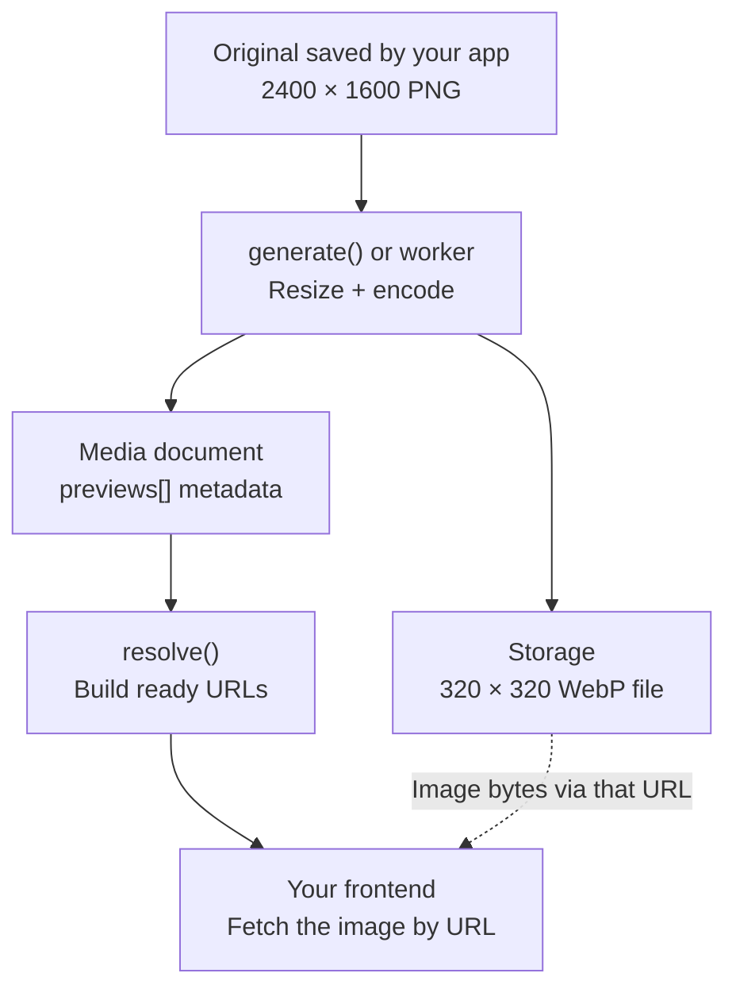
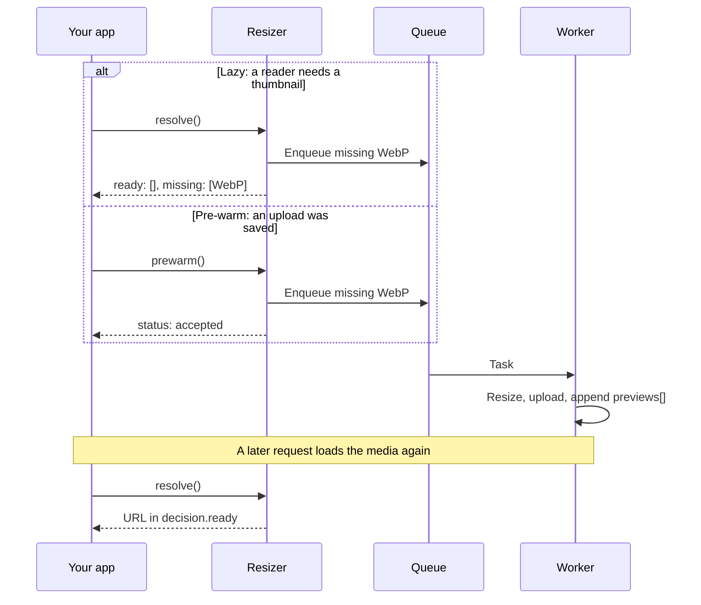

# Image Resizing

`@adaptivestone/framework-module-resize` makes resized copies of uploaded images. You store the uploaded **original** once. The module then creates **previews**, such as a `320×320` thumbnail and a `620`-pixel-wide detail image, with [`sharp`](https://sharp.pixelplumbing.com), stores them, and records them on your media document. When you build a response, it turns that record into image URLs.

- **Original**: the uploaded file, stored unchanged and privately.
- **Preview**: a generated image file. Its metadata is stored in the media document's `previews[]`.
- **Variant**: one requested size and format, plus optional filters. One size in JPEG, WebP and AVIF is three variants, and so three files.

The module handles resizing, storage calls and deciding which URLs are ready. Your app handles the upload endpoint, the media model, access checks, the response shape and deleting files.

<div className="resize-diagram" role="region" aria-label="From an uploaded original to a displayable preview" tabIndex={0}>



</div>

## Choose a workflow

| You want… | Call | The call waits for… | It returns |
|---|---|---|---|
| Previews ready when the upload request finishes | `generate()`: **eager** | resizing, upload and saving | `{ created, failed }` |
| A fast upload, with previews made in the background | `prewarm()`: **pre-warm** | queueing and its confirmation | `{ status, … }` per variant |
| Previews only for the sizes readers actually request | `resolve()` with a queue: **lazy** | queueing of the missing variants | `{ decision, output }` |

Every workflow reads URLs with `resolve()` and writes the same `previews[]`. You can mix them, for example pre-warm thumbnails and let detail sizes generate lazily. You can also switch later without migrating data. Start with eager, and add the [queue](#background) when uploads must stay fast.

## Set up

### 1. Install and scaffold

You need Node `>=24`, `@adaptivestone/framework` `^5.1.0`, and `mongoose` 9 (already in a framework app). Upgrading from 0.3.x? Before you upgrade, read [`UPGRADING.md`](https://github.com/adaptivestone/framework-module-resizer/blob/main/UPGRADING.md): it lists what to change before you run `npm i`. From your app's root:

```bash
npm i @adaptivestone/framework-module-resize
npx --no -- resize-scaffold --eager
```

Run it after the install. `--no` refuses to install a package of that name from the registry when this one is missing, and npm stops with an error. `--` hands the options to this command, not to npm.

- `--eager` creates `src/resizer.ts` and `src/config/resize.ts`. Without it, the command also creates the queue model and the worker command (see [background generation](#background)). With a queue and a media model not named `File`, set `static fileRef = 'Media'` in `src/models/ResizeTask.ts`, as that file's comment says.
- It never overwrites existing files; `--force` does.
- It appends `/var/` to your `.gitignore` in the run that writes the config, because private originals must never reach version control. Files already tracked there stay tracked, and new ones are ignored. A `!` line for `var` beside your own rule stays, and gets a warning: check with `git check-ignore var/media-private/x`.
- It adds a pointer to the package's agent guide to your `AGENTS.md`. Use `--agents claude|print|skip` to change that.
- In CI, run `npx --no -- resize-scaffold --check` (`--check --eager` for eager apps). It fails when a generated file is missing or has been changed in a way that breaks it.

### 2. Add the fields to your media model

```ts
// src/models/File.ts
import { BaseModel } from '@adaptivestone/framework/modules/BaseModel.js';
import { resizeMediaSchemaFragment } from '@adaptivestone/framework-module-resize/framework.js';

export default class File extends BaseModel {
  static get modelSchema() {
    return { name: { type: String }, ...resizeMediaSchemaFragment } as const;
  }
}
```

The fragment adds:
- `original`: where the original is stored, plus its format, size and dimensions.
- `previews[]`: one entry per generated file. Besides its URL fields, each entry records `bytes`, `createdAt`, `origin` (which original it was made from) and `encodeSig` (what it was encoded with: its format's encode settings, the sharpen setting of its fit mode, its animation settings (for animated formats: `animated`, `limits.animationFrames` and the pixel budget `min(limits.sourcePixels, limits.inputPixels)`, which also caps the frames at the larger of the source's and the preview's size), the result-dimension cap, the fit box (for fit rows) and the pipeline `version`). Its `identity` field lets the media store keep one entry per preview. A hand-written schema that declares preview entries as strict sub-documents needs `identity`, `origin`, `encodeSig`, `sizeKey`, `format` and `contentType` in them, each `{ type: String }`, `storageRef` as `{ type: 'Mixed' }`, and `fit` as `{ type: Boolean }`; `verify()` reports `RESIZE_MONGO_MEDIA_MODEL_OUTDATED` without the first seven and logs one warning without `fit`. An entry replaced under 0.3.0 has no stored `_id` and reads a new random one on each load until it is next replaced, so key entries by `identity`, and remove such an entry by `identity` or with `invalidate()`.

Keep Mongoose's `minimize: false`, which is the `BaseModel` default, because storage locators can contain empty objects. Save the media document before you generate previews; the module never creates it.

### 3. Configure

```ts
// src/config/resize.ts
import {
  defaultFrameworkResizeConfig,
  type FrameworkResizeConfig,
} from '@adaptivestone/framework-module-resize/framework.js';

export default {
  ...defaultFrameworkResizeConfig,
  mediaModelName: 'File', // your media model
  storage: { driver: 'local', rootDir: './var/media', privateRootDir: './var/media-private',
    publicBaseUrl: process.env['RESIZE_PUBLIC_BASE_URL'] || 'http://localhost:3300/media' },
} satisfies FrameworkResizeConfig;
```

The module merges the image settings over the package defaults, so a key you leave out keeps its default; spreading the defaults, as the scaffold does, keeps them visible in the file. It then validates the result and throws `ResizeConfigError` if anything is wrong. Put environment-specific changes in `resize.production.ts` and similar files; the framework merges them. For example, S3 in production only:

```ts
// src/config/resize.production.ts
import type { FrameworkResizeConfig } from '@adaptivestone/framework-module-resize/framework.js';

export default {
  storage: {
    driver: 's3',
    bucketPublic: 'my-cdn',
    bucketPrivate: 'my-originals',
    publicBaseUrl: 'https://cdn.example.com',
  },
} satisfies Partial<FrameworkResizeConfig>;
```

An override that changes only nested keys, such as `limits: { sourcePixels: 20_000_000 }`, writes `satisfies PartialFrameworkResizeConfig` (from `…/framework.js`) instead. All options are listed under [configuration](#configuration).

### 4. Create the Resizer

```ts
// src/resizer.ts
import { FrameworkResizer } from '@adaptivestone/framework-module-resize/framework.js';

export const resizer = new FrameworkResizer({ pipelines: { default: {} } });
```

`FrameworkResizer` builds everything else from `src/config/resize.ts`: the image settings, the storage, the task queue, the media store (`FrameworkMediaStore`, over your media model `mediaModelName`), for a queue that cannot gate by itself, such as SQS, the lock store (`FrameworkLockStore`, the framework's `Lock` model; the database queue needs none), and the app logger. So `src/resizer.ts` holds only behaviour: pipelines and hooks. Options win over the config; for example, `new FrameworkResizer({ storage: new S3Storage({ …, client }) })` reuses your own S3 client. Import `src/resizer.ts` wherever you need the Resizer; a normal static import is fine, because nothing is read from the framework until first use. Elsewhere in your code, `getResizer()` returns the same instance.

A dead-code tool may flag the `resizer` export of `src/resizer.ts` when you use `getResizer()`: import it by name, or ignore that export.

A config mistake then shows up at the first upload or read. To catch it at startup instead, verify after initialization:

```ts
// src/server.ts
await server.init();
await resizer.verify(); // config, storage, the media model, the task queue (ResizeTask model, its gate index, and the queue), and the Lock model when its queue is on SQS
await server.startServer();
```

The module writes local files, and you serve them: see [Serve local files](#serve-local-files). For S3, see [drivers](#drivers).

### 5. Store the original at upload

```ts
import { getResizer } from '@adaptivestone/framework-module-resize';

fileDoc.original = await getResizer().uploadOriginal({
  body: buffer, // the uploaded bytes
  visibility: 'private',
  // namespace: 'avatars', // optional key prefix; not access control
});
await fileDoc.save();
```

Previews inherit the namespace, so it appears in their public URLs: do not put anything in it that you would not publish, such as a user id. Each `/`-separated part may hold letters, digits, `_`, `.` and `-`. Set it at upload and keep it: it is part of `storageRef`.

`uploadOriginal()` detects the format and dimensions with its decoders (Sharp for raster images and SVG), then stores the bytes unchanged under a random name. It returns the value to save as `original`. It does not create the document or queue any work. Input larger than `upload.maxBytes` (25 MiB by default), or in a format not listed in `upload.formats`, throws `ResizeOriginalError`.

Save `original` exactly as returned, and do not change it later: every preview records a signature of its `storageRef` and size, so a changed ref regenerates that media's previews. Its `storageRef` is the storage driver's own locator: `{ path, visibility }` for local files, `{ bucket, key }` for S3. To put an object you already hold on the module, see [Adopting on an app with existing media](#adopting).

### Serve local files {/* #serve-local-files */}

`LocalFsStorage` writes previews to `rootDir`, and private originals to `privateRootDir`, which defaults to `rootDir` + `-private` and so sits **beside** it. Serve exactly `rootDir`. Never serve a parent of it: the module cannot detect that, and it would expose every original, untrusted SVG included. An empty or whitespace-only `rootDir` or `privateRootDir` is refused with `RESIZE_CONFIG_INVALID`; `'.'` is the working directory. An override that moves `rootDir` must move the scaffold's `privateRootDir` too: it no longer follows.

`publicBaseUrl` must be absolute for a frontend on another origin. The scaffold reads `RESIZE_PUBLIC_BASE_URL`; its default assumes the framework's port 3300. Changing it later regenerates nothing, because URLs are built at read time and are in no signature. An empty or missing `RESIZE_PUBLIC_BASE_URL` in production gives `localhost` URLs in API responses, with no warning: set it in every deployed environment.

**Development**, on the API. Tested by this module on the framework's own server. The framework serves no static files, and `bootHttp` runs before its 404 page:

```ts
// src/bootHttp.ts
import type { BootHttpHook } from '@adaptivestone/framework/server.js';

const bootHttp: BootHttpHook = async (app) => {
  if (process.env['NODE_ENV'] === 'production') return; // a reverse proxy or a CDN serves these files
  const { default: express } = await import('express'); // npm i -D express
  app.httpServer?.express.use('/media', express.static('var/media', { dotfiles: 'ignore', index: false, immutable: true, maxAge: '1y' }));
};
export default bootHttp;
```

Pass it as `new Server({ folders, bootHttp })`. A strict `tsc` also needs `npm i -D @types/express`; the recipe runs without it. Any other static server over `var/media` works too, with `RESIZE_PUBLIC_BASE_URL` pointing at it.

**Production**, not run by this project: a reverse proxy or a CDN over the same folder, never the API.

```nginx
location /media/ {
  alias /srv/app/var/media/;
  expires 1y;
  add_header Cache-Control "public, immutable";
  add_header X-Content-Type-Options nosniff;
  try_files $uri =404;
}
```

With Caddy, inside your site block:

```
handle_path /media/* {
  root * /srv/app/var/media
  header Cache-Control "public, max-age=31536000, immutable"
  header X-Content-Type-Options nosniff
  file_server
}
```

File names are new per write, so the long cache is safe. If you write your own files under `rootDir`, give each a new name.

## Sizes and formats

Define a fixed catalog of sizes for each use, and pass the same catalog when you generate and when you read:

```ts
// src/mediaSizes.ts
import type { PreviewFormat, SizeInput } from '@adaptivestone/framework-module-resize';

export const thumbnailSizes: SizeInput[] = [{ width: 320, height: 320 }];
export const detailSizes: SizeInput[] = [{ width: 620 }, { fit: true }];
export const previewFormats: PreviewFormat[] = ['webp']; // the examples use one format
```

| Size | Key | Result for a `2400×1600` original |
|---|---|---|
| `{ width: 320, height: 320 }` | `320x320` | `320×320`, cropped from the center |
| `{ width: 620 }` | `620w` | about `620×413`, aspect ratio kept |
| `{ height: 400 }` | `400h` | `600×400`, aspect ratio kept |
| `{ fit: true }` | `fit` | `1800×1200`: the whole image inside `maxSize` (`2000×1200`), never enlarged |

For a pipeline without `variantSteps`, a raster original no larger than the requested width and height is never enlarged or cropped: its preview keeps the original's size (scaled down only to fit `limits.resultDimension`), without metadata such as EXIF or GPS. A pipeline with `variantSteps`, such as a watermark, always gets the full box its steps were written for. Fractional dimensions are rounded to whole pixels. No side of a preview other than `fit` exceeds `limits.resultDimension` (5000): when the side derived from the aspect ratio of a width-only or height-only size would, the preview is cropped to it.

| Size | Source | Result |
|---|---|---|
| `WxH` | Raster, fits inside the box on both sides | Its own size: not enlarged, not cropped |
| `WxH` | Larger than the box on one side only | Exactly `WxH`, cropped, **the short side enlarged** |
| `WxH` | Larger on both sides | Exactly `WxH`, cropped |
| `{ width }` or `{ height }` | Any | That side exactly, aspect kept: **enlarged when the source is smaller on that side** |
| `{ fit: true }` | Any | Inside `maxSize`, never enlarged |

For example, a `100×60` raster source gives `100×60` for `160x160`, `80×80` for `80x80`, `200×40` for `200x40` and `620×372` for `{ width: 620 }`. An SVG gets the full box: a `100×60` SVG gives `160×160` for `160x160`.

So a size key does not promise a size. Read the preview's real size from `width` and `height`. A pipeline with `variantSteps` always gets the full box.

:::warning

**The catalog is an allowlist.** Never pass dimensions from the client into `sizes`. Map a client choice such as "thumbnail" to your catalog. Otherwise anyone can make your server resize images to any size they like.

:::

Formats are the output format IDs of the engine; the default engine takes Sharp's, aliases such as `jpg` included.
- The `formats` config defaults to `['jpeg', 'webp', 'avif']`, and a call can override it with `formats`.
- Each format is a separate file, so three sizes in three formats make nine files per image.
- Use `'jpeg'`, not `'jpg'`: the default encoder options and the flatten list name `jpeg`, and a `'jpg'` they do not name leaves transparent areas black. JPEG previews put them on a white background. If you keep a `'jpg'` entry, name it in `encode.flatten.formats` too. That changes its signature, so its stored previews regenerate.
- Other Sharp formats, such as `'png'` or `'tiff'`, work once you add them to both `formats` and `encode.formats`. A per-call format without an `encode.formats` entry, or one a `beforeEnqueue` hook adds, is never generated: `resolve()` skips it, `prewarm()` reports `RESIZE_FORMAT_NOT_CONFIGURED`, and `generate()` throws.
- SVG is accepted only as an original, and its previews are always raster images: the worker renders the SVG once per task, in a separate process and before any pipeline step, and makes every format from that render. `beforeSteps` receive the rendered pixels as a `Raster`, never SVG markup.

## Generate now (eager)

```ts
import { getResizer } from '@adaptivestone/framework-module-resize';
import { previewFormats, thumbnailSizes } from './mediaSizes.ts';

const { created, failed } = await getResizer().generate({
  media: fileDoc,
  sizes: thumbnailSizes,
  formats: previewFormats,
});
```

`generate()` downloads the original, resizes it, uploads the previews and adds their metadata to `previews[]`, all before it returns. The metadata goes both into MongoDB and onto `fileDoc`, so don't add it again. Reload the media before saving it after `generate()` or `invalidate()`; the module wrote the rows itself (on a Mongoose document the changed `previews` is marked modified, and saving the stale list would drop previews a worker stored since it was loaded). No queue or worker is needed.

| Field | Meaning |
|---|---|
| `created` | `Preview[]`: the files this call made. Up-to-date previews that already existed are skipped and not listed; [outdated](#operations) ones are made again. |
| `failed` | The number of variants that failed. `failed > 0` is a partial success: the successful previews are saved. |
| `replaced` | The storage refs of every row this call's write removed: the outdated previews it replaced, or a copy of the same preview another worker stored meanwhile. A ref a new row of that write or the original holds is left out, because that file is in use. Set only when there were some. Their files are not deleted. |

`generate()` throws `ResizeGenerateError` if every variant fails, and `ResizeNoOriginalError` if the media has no original. So `{ created: [], failed: 0 }` means nothing new was needed. The `ResizeGenerateError` has `retryable: false` when every variant failed with `retryable: false`. A source the engine refuses rejects before any variant runs: on a cut JPEG, which 0.3.0 rendered, `generate()` rejects with `ResizeMediaError` `RESIZE_SOURCE_DAMAGED`, not `ResizeGenerateError`, so a handler catching only `ResizeGenerateError` returns 500 on a user's upload; catch `ResizeError`, or refuse the file at upload with `upload.verify: 'decode'`. `failed` is only a count; the error's `cause` is the first failure, and the logs say which variant failed and why, each in a `warn` line.

With `persist: false`, the files are uploaded but their metadata is not saved, so store `created` yourself. Eager calls take no locks, so two concurrent calls for the same media can both generate the same variants.

## Read URLs

```ts
import { formatPictureUrls, getResizer } from '@adaptivestone/framework-module-resize';

const { decision } = await getResizer().resolve({
  media: fileDoc,
  sizes: thumbnailSizes,
  formats: previewFormats,
});
const picture = formatPictureUrls(decision, { id: String(fileDoc.id) });
// { id: '65f0…', sizes: { '320x320': { webp: {
//   url: 'https://media.example.com/previews/8d0e2b7c.webp',
//   contentType: 'image/webp',
//   width: 320,
//   height: 320,
// } } } }
```

`width` and `height` are the preview's real size, useful for ``, and are absent on a row that does not record them.

With strict types, a loaded Mongoose document is not a `MediaLike` (Mongoose types the nested fields as nullable): pass it as `media: doc as MediaLike` (`import type { MediaLike }` from the main entry), or type the model's `original` and `previews` paths with `Original` and `Preview`.

`resolve()` never resizes and never throws. It returns:

| Field | Meaning |
|---|---|
| `decision.ready` | Stored previews that can be served now, each with `sizeKey`, `format`, `url`, `contentType` and the `preview` row; never the original. An outdated preview is served too, with `stale: true` |
| `decision.missing` | Variants that cannot be served yet; they have no URL |
| `decision.stale` | Variants that would replace an outdated preview, as left after your `beforeEnqueue` hook; set only when there is one. It does not confirm that they were queued (no queue, a queue that cannot be used, `enqueueMissing: false`), nor that the old preview was served |
| `output` | The return value of your `formatPublicUrls` hook, or `undefined` if you have none |

`formatPictureUrls()` leaves missing sizes out of its map, so show your own placeholder for them.
- **With a queue configured:** `resolve()` also queues the missing variants, and the replacements of outdated ones. Pass `enqueueMissing: false` to only read.
- **Without a queue:** it only reads.
- **New previews:** `resolve()` never waits for the worker. To see new previews, load the media again on a later request.

`formatPictureUrls()` also skips variants that have filters; build the response from `decision` yourself for those. To get your own response shape directly, register a hook once: `getResizer().hook('formatPublicUrls', (decision) => toMyDto(decision))`. `output` then holds what that hook returns.

On list pages, select only the module's fields and resolve one bounded page:

```ts
import { resizeMediaPaths } from '@adaptivestone/framework-module-resize/framework.js';

const files = await File.find(query).select([...resizeMediaPaths, 'name']).limit(20).lean();
const pictures = await Promise.all(
  files.map(async (file) => {
    const { decision } = await getResizer().resolve({ media: file, sizes: thumbnailSizes, formats: previewFormats });
    return formatPictureUrls(decision, { id: String(file._id) });
  }),
);
```

`resolve()` uses only the fields you loaded. It never throws, so this is safe.

**What a read costs,** per media read, one size in one format, on a local replica set. A read that finds every preview ready does no I/O: about 0.03 ms, and under 0.2 ms for 5 sizes in 3 formats. On the database queue, a read with previews missing or outdated asks the queue:

- While a task waits: one indexed query, about 0.2 ms.
- When it adds a task: that query and one insert, 6 to 10 ms.
- Past a dead task's cooldown: that query and two writes, 12 to 19 ms.

Your network adds to each of them. A page of 20 with a task waiting for each makes 20 queries, about 2 ms here in parallel, and a worker outage keeps every affected page there. For a hot public list, call `prewarm()` at upload and pass `enqueueMissing: false` on the list, and leave lazy reads on the detail route, so that it heals anything a `prewarm()` missed.

## Generate in the background {/* #background */}

### Add the queue and the worker

1. Run the scaffold without `--eager`. It adds `src/models/ResizeTask.ts` (the queue's model) and `src/commands/ResizeWorker.ts` (the worker command), and keeps your existing files:

   ```bash
   npx --no -- resize-scaffold
   ```

2. Define the queue, where tasks wait for the worker, name it as the Resizer's queue, and allow the worker to run. In `src/config/resize.ts`:

   ```ts
   queue: 'default', // this Resizer's queue: a key of `queues`
   queues: { default: { driver: 'database' } }, // tasks in the ResizeTask model; or { driver: 'sqs', queueUrl }
   worker: { enabled: true }, // every worker key is optional; defaultWorkerOptions holds the rest
   ```

   `queues`, `worker` and `coordination` are process-wide: they are read only from `src/config/resize.ts`, for every Resizer of the process and for the worker. `queue: false`, or no `queue` key while `queues` is empty, is eager only. A `queue` name that `queues` does not define is `RESIZE_CONFIG_QUEUE_UNKNOWN`, so with `queue: 'default'` kept in the file, a missing `queues` is that error too. `worker.enabled` only permits the worker command; the API never starts a worker. `src/resizer.ts` does not change.

3. Check the queue timing if your images are large: each `queues` entry also takes `leaseMs`, `maxAttempts` and the other [timing options](#configuration), for that queue only.

4. Create the indexes. `ResizeTask` declares its indexes (and so does the framework's `Lock` model, which only a queue that cannot gate by itself, such as SQS, uses). Create them through your normal migration or deployment process before you deploy the API and the worker. The module never creates indexes at runtime. One task per media, pipeline and queue depends on the gate index, so `resizer.verify()` and the worker refuse to start without it (`RESIZE_MONGO_INDEX_MISSING`). When Mongoose builds your indexes itself (`autoIndex`, on by default in the API server), `verify()` waits for that build, so the boot check passes on a fresh database too. The worker does not: the framework CLI that runs it turns `autoIndex` off, so it builds no index and does not wait for one, and a worker started before the gate index exists stops with `RESIZE_MONGO_INDEX_MISSING`, even on a fresh database. Create the indexes before the first worker starts: through a migration that runs before the API and the worker (the order that always works), or, on a new database only, by starting the API first and letting its `verify()` pass (the build is Mongoose's own `autoIndex`, no code of yours). When you upgrade from an earlier version, create them through a migration, in this order. Create the gate index `{ resizer: 1, fileId: 1, pipeline: 1, queue: 1 }` (unique, partial on `active: true`) BEFORE the new API and workers start: without it concurrent adds can each store a task, duplicate active tasks build up, and building the unique index then fails (E11000) until those tasks are no longer active (completed, or dead and taken over or expired). Create the claim index `{ queue: 1, status: 1, availableAt: 1 }` before or together with the new workers, then drop the old `{ status: 1, createdAt: 1 }` (or `{ queue: 1, status: 1, createdAt: 1 }`) index. Then drop the `requestKey` index (`{ fileId, pipeline, requestKey }`) when convenient.

5. Start the worker as a separate long-running process, kept running by your process manager:

   ```bash
   npm run cli ResizeWorker
   ```

The scaffolded command imports `src/resizer.ts`, so the worker has the same Resizers as the API:

```ts
// src/commands/ResizeWorker.ts (scaffolded)
import '../resizer.ts';

export { ResizeWorker as default } from '@adaptivestone/framework-module-resize/framework.js';
```

Keep that import if you edit the command; `npx --no -- resize-scaffold --check` reports a command without it. The API and the worker must use the same database and the same storage. With `LocalFsStorage` that means the same filesystem; for workers on other machines, use S3 or other shared storage.

### Lazy and pre-warm

<div className="resize-diagram resize-diagram--sequence" role="region" aria-label="Lazy and pre-warm calls do not wait for background generation" tabIndex={0}>



</div>

**Lazy** needs no extra code: `resolve()` queues whatever is missing. **Pre-warm** queues the catalog right after the upload is saved, so the worker usually finishes before the first reader arrives:

```ts
const result = await getResizer().prewarm({
  media: fileDoc,
  sizes: thumbnailSizes,
  formats: previewFormats,
});
if (result.status === 'incomplete') {
  // result.unconfirmed: variants without a confirmed task
  // result.issues: why, and whether a retry can help (issue.retryable)
}
```

`prewarm()` never throws, and it reports every requested variant. All variants for one media and pipeline on one queue go into one task, and only one such task is active at a time: while it waits, runs or retries (and for `coordination.cooldownMs` after it is dead-lettered), reads and pre-warms queue nothing new for that media and pipeline on that queue. A size that is still missing is queued by the next read or pre-warm after the task ends. A request on another queue is a separate task.

| `status` | Meaning |
|---|---|
| `'ready'` | Nothing needs queueing, and at least one requested variant is already stored |
| `'accepted'` | Every variant that needs queueing has a confirmed task (`result.tasks`) |
| `'not-required'` | Nothing to do: the request was empty, or the `beforeEnqueue` hook removed everything |
| `'incomplete'` | At least one variant has no confirmed task, for example because there is no task queue or no original |

The arrays `ready`, `accepted`, `notRequired` and `unconfirmed` split the requested catalog, and `result.tasks` holds the task receipts. When a task for the same media, pipeline and queue is already active, the database queue looks it up: `prewarm()` accepts the variants that task holds, and returns the others as `unconfirmed` with the retryable `RESIZE_TASK_IN_FLIGHT` issue; call `prewarm()` again after the task ends. SQS, which gates with a lock, reports every variant as `unconfirmed` with the retryable `RESIZE_ENQUEUE_LOCK_CONTENDED` issue while the lock is held. An unexpected error, for example a media document without an ID, is `incomplete` with a `RESIZE_ENQUEUE_INTERNAL_ERROR` issue. The [issue reference](https://github.com/adaptivestone/framework-module-resizer#prewarm-issues) lists every issue code, when it happens and its `retryable`.

#### Before the worker has run

```ts
const { decision, output } = await getResizer().resolve({ media: file, sizes });
return {
  picture: output ?? formatPictureUrls(decision, { id: String(file._id) }),
  pending: decision.missing.length > 0, // the client shows a placeholder and asks again
};
```

You have three choices:

- **A placeholder** from `pending`, with no latency, where the client handles it. Cap the polling, and test `hasOriginal(file)` first: `pending` stays `true` with nothing on the way for a dead task on a cut file, a row with no original, and a just-uploaded row on an eager-only Resizer.
- **`generate()` on that one route**, for the user who just uploaded. It is supported beside a queue and keeps one row per preview, while the request waits for Sharp. A worker that renders the same variants meanwhile leaves a second set of files with no row, as described below.
- **`generate()` of the smallest size and `prewarm()` of the rest**, which gives the response one real image without the whole wait.

On such a route call `generate()` before any `resolve()`. A task queued first and claimed after `generate()` finishes finds the variants fresh, renders nothing, and logs one harmless "already fresh" warning. If a worker claims a task during `generate()`, because one was queued first or another request's read queued one meanwhile, both render: 3 sizes in 3 formats made 18 files for 9 rows. Reads stay right, since the rows stay one per preview, but the second set of files stays in storage. The log line "resize: … were already stored by another worker; uploaded but not recorded storage refs: …" names them, or sweep preview objects that no row references, by the rule under [Outdated previews](#operations).

`sizes` is an allowlist on every route. A real frontend during this window is not tested here.

### Queues and workers {/* #named-queues */}

Every task waits in a named queue. When you don't name one, it is `'default'`.

| You want… | How |
|---|---|
| Another queue | An entry in `queues` of `src/config/resize.ts`, e.g. `bulk: { driver: 'database', leaseMs: 120000 }` |
| A Resizer's tasks on another queue | `queue: 'bulk'` in its config file, or `new FrameworkResizer({ …, queueName: 'bulk' })` |
| One call's tasks on another queue | `prewarm({ …, queue: 'bulk' })`; `resolve()` also accepts `queue` |
| A worker for `'default'` | `npm run cli ResizeWorker` |
| A worker for another queue | `npm run cli ResizeWorker -- --queue=bulk` |
| One worker for several queues | `npm run cli ResizeWorker -- --queue=default --queue=bulk` |
| A queue on another backend | An entry with its own driver, e.g. `bulk: { driver: 'sqs', queueUrl: '…' }` beside the database `default` |

A worker consumes the queues you name with `--queue`, which you may repeat; every name must be served, or the worker stops before it takes a task (`RESIZE_QUEUE_NOT_SERVED` naming it). A common setup keeps uploads and reads on `'default'` and runs a large backfill on `'bulk'` with its own worker, so the backfill never delays new uploads. The one-task-at-a-time rule is per queue: a task waiting on `'bulk'` never blocks reads on `'default'` for the same media. The media may then be rendered on both queues: each preview is still stored once, but the losing render costs its upload and leaves an orphaned file, which a warning lists. To avoid it, read such a media with `queue: 'bulk'` until its task ends, as a [backfill](#adopting) does.

Each queue is defined once, by name, with its own timing. Queues on one backend share one task queue: every `database` entry, and the SQS entries with the same `region`, `endpoint`, `deadLetterQueueUrl` and `waitTimeSeconds`. Queues on different backends work side by side: each call goes to its queue's backend, and the one-task-at-a-time rule is kept there (by the task row on the database, by a lock in the framework's `Lock` model on SQS). So an environment file may move only some queues, for example `queues.default` to SQS in `resize.production.ts` while `bulk` stays on the database. A backend is built when one of its queues is first used, so an SQS entry nothing uses never loads the AWS SDK; where that SDK is not installed, that backend's queues are not served (`prewarm()` reports `RESIZE_QUEUE_NOT_SERVED` naming the package, and `resolve()` logs it once per queue name), while the other queues keep working. A call on a name `queues` does not define queues nothing the same way. With queues on two backends, `resizer.tasks` routes between them: to find the backend of a queue, ask `await carrierOf(resizer.tasks, 'default')` (from the main entry) rather than checking the class. `resizer.queueName` tells a Resizer's queue; when the name comes from the config file, it is readable after `await resizer.ready()` or the first call.

Any number of workers, on any number of servers, can consume one queue; each task is processed by one worker at a time. If a worker dies, its lease (its time-limited hold on the task) expires and another worker takes the task. A task can therefore run more than once, but the worker skips previews that already exist.

### Push delivery (preview) {/* #push-delivery */}

An SQS-triggered Lambda can run queued tasks instead of a worker process, with the same lease, retries, dead-letters and gate. Use it when you have no process to keep running: a long-lived worker is the simpler choice when you already run one. **It has not run on real AWS.** Everything here was measured on one machine, with local stand-ins and a model, so it stays a preview until the package's check list passes.

Settings to get right first, in the order that saves tasks:

1. **`ReportBatchItemFailures` in the trigger's `FunctionResponseTypes`.** Without it Lambda deletes every message of a normal return, so a failing task is gone after its first failure, with no copy, while its line says `retrying in 5000 ms`. The handler cannot detect this.
2. **Batch size 1, with no batch window.** Records of a batch run one after another. One that does not fit in the time left is not started, yet its delivery counts as an attempt, so healthy tasks die unrun.
3. **A function timeout well above your slowest task.** Start at 300 s. Lambda's default 3 s runs no task at all.
4. **Redrive `maxReceiveCount` = `maxAttempts` + 2** (7 for the default 5). Too low, and SQS moves the message itself, with no module line, hook or cooldown.
5. **A visibility timeout at least 6 × the function timeout**, which is AWS's rule. Set `coordination.gateTtlMs` at or above it.
6. **A `deadLetterQueueUrl` in the queue's entry.** Without one a dead task is deleted at its last delivery.
7. **The IAM permissions `AWSLambdaSQSQueueExecutionRole` lacks:** `sqs:ChangeMessageVisibility` on the queue, `sqs:SendMessage` on the dead-letter queue, and S3 get and put.
8. **`MaximumConcurrency` on the trigger, rather than low reserved concurrency.** Reserved concurrency throttles, and a throttled receive may count as an attempt.

What else you need:

- A standard SQS queue. FIFO queues are not supported.
- S3 storage, with a private bucket, since `local` does not outlive the Lambda environment.
- A Mongo host, with its indexes made by your migration. The gate lives in a lock, so SQS needs no gate index.
- With a customer managed KMS key on a queue, the role also needs `kms:Decrypt` on the queue's key, and `kms:Decrypt` and `kms:GenerateDataKey` on the dead-letter queue's, per AWS.
- `MaximumConcurrency` set to your Mongo connection budget ÷ `maxPoolSize`. It applies per trigger, so the budget is shared: their combined concurrency stays within it. Triggers on `default` and `bulk`, at 100 connections and `maxPoolSize` 10, get 5 each, since 10 each would be 20 environments and 200 connections.

The handler of a plain Node host:

```js
// handler.mjs
import mongoose from 'mongoose';
import { createResizer } from '@adaptivestone/framework-module-resize';
import { resizeMediaSchemaFragment } from '@adaptivestone/framework-module-resize/drivers/mongo.js';
import { createSqsHandler } from '@adaptivestone/framework-module-resize/lambda.js';

const connection = await mongoose
  .createConnection(process.env.MONGO_DSN, {
    autoIndex: false, // indexes come from your migration
    maxPoolSize: 5,
    serverSelectionTimeoutMS: 5000, // the default 30 s would outlast Lambda's 10 s init
    maxIdleTimeMS: 60000,
  })
  .asPromise();
// Your media model, on its collection.
const File = connection.model(
  'File',
  new mongoose.Schema({ ...resizeMediaSchemaFragment }, { minimize: false }),
);

createResizer(
  {
    // Your API's image settings go here too: both must match.
    concurrency: 1,
    storage: {
      driver: 's3',
      bucketPublic: process.env.PUBLIC_BUCKET,
      bucketPrivate: process.env.PRIVATE_BUCKET,
    },
    database: { driver: 'mongo', connection, mediaModel: File },
    queues: {
      default: {
        driver: 'sqs',
        queueUrl: process.env.QUEUE_URL,
        deadLetterQueueUrl: process.env.DEAD_LETTER_QUEUE_URL,
      },
    },
    coordination: { gateTtlMs: 1800000 }, // at or above the queue's visibility timeout
  },
  { pipelines: { default: {} } },
);

export const handler = createSqsHandler({
  sharp: { concurrency: 1, cache: false },
});
```

A task runs as on a worker: each delivery holds a lease, a failure retries with backoff, a dead task goes to the dead-letter queue, and the gate keeps one task per media, pipeline and queue. A stop before the function timeout keeps the finished previews, so the retry renders only the rest. A hard kill loses the attempt.

An outage or a bad deploy costs healthy tasks. With Mongo down or a wrong DSN no task runs, yet each failed invocation uses a receive. Past `maxAttempts` the first delivery after the fix is dead unrun, with `RESIZE_TASK_MAX_ATTEMPTS`, and past `maxReceiveCount` SQS moves the message, with no module line, hook or cooldown. At a 300 s function, a visibility timeout of 1800 s and the default settings, those come after about 2 h and about 3 h. During a known outage disable the trigger, with `aws lambda update-event-source-mapping --uuid <UUID> --no-enabled`: the messages wait, up to the queue's retention. Afterwards call `prewarm()` again for what the dead-letter queue holds.

**Framework hosts**, tried only on a minimal host so far. Build the app by hand before the handler exists, and define the queue in `queues` of `src/config/resize.ts`, with its `coordination` beside it:

```js
// handler.mjs
import mongoose from 'mongoose';
import Server from '@adaptivestone/framework/server.js';
import { createSqsHandler } from '@adaptivestone/framework-module-resize/lambda.js';
import folderConfig from './folderConfig.js'; // the same folders your server starts with

mongoose.set('autoIndex', false);
const server = new Server(folderConfig);
await server.init({ isSkipModelInit: true, isSkipModelLoading: true });
await server.getModelFilesPathsWithInheritance();
await server.initAllModels({ waitForConnection: true });
await import('./resizer.js'); // the file that constructs your Resizers

export const handler = createSqsHandler({
  sharp: { concurrency: 1, cache: false },
});
```

It reads no `worker.enabled`. Put `maxPoolSize=5&serverSelectionTimeoutMS=5000&maxIdleTimeMS=60000` in the `MONGO_DSN` query: the framework passes only `appName` to `mongoose.connect`, so otherwise Mongoose's default pool of 100 and 30 s server selection apply.

Packaging: do not bundle, and ship `node_modules` whole. The module looks for its optional peers on disk beside itself, and starts SVG's child process from `svgRasterChild.js` next to its own file, so a bundler breaks it in ways that depend on the flags. Sharp's binary must match the function's architecture: for an `arm64` function, in a clean copy, run `npm install --omit=dev --os=linux --cpu=arm64 --libc=glibc`. A mismatch fails at import, before your handler runs.

The options, the other settings, what each wrong setting costs, the measured numbers and the troubleshooting table are in the [README reference](https://github.com/adaptivestone/framework-module-resizer#push-delivery-preview).

## More than one Resizer

Most apps need one Resizer. Create more when parts of the app need different storage, media models or formats, for example avatars and listings:

```ts
// src/resizer.ts
export const resizer = new FrameworkResizer(); // 'default', src/config/resize.ts
export const listings = new FrameworkResizer({
  name: 'listings',
  configName: 'resizeListings', // src/config/resizeListings.ts: this Resizer's own settings
});

// elsewhere: getResizer('listings').resolve({ … })
```

- **One construction per name:** each name can be created only once per process.
- **Create them all in `src/resizer.ts`:** every task records which Resizer created it, and the worker gives the task to the Resizer with that name, so the worker needs all of them. Creating them in `src/resizer.ts` gives both the API and the worker the same set.
- **Own config files:** each file spreads `defaultFrameworkResizeConfig`, `satisfies FrameworkResizeConfig`, and holds its Resizer's own media model, storage, image settings and `queue`: a name from `queues` in `src/config/resize.ts`, such as `queue: 'bulk'`. `queues`, `worker` and `coordination` stay in `src/config/resize.ts`; in another file they are `RESIZE_CONFIG_INVALID`. Resizers whose queues are on one backend share one task queue. The worker runs one loop per backend and queue it consumes, one task at a time each, and processes each task with its own Resizer.
- **No mixing:** previews from different Resizers never mix.
- **Worker settings:** the worker reads `worker` (`enabled` and the Sharp tuning) and `queues` from `src/config/resize.ts`, and from no other file: the old `--config` flag is removed (`RESIZE_CONFIG_REMOVED_KEY`). An app whose Resizers all read other files keeps a `src/config/resize.ts` with only the process-wide sections, written `satisfies Partial<FrameworkResizeConfig>`.

## Pipelines, filters and hooks

If you register nothing, the module only resizes and encodes. For custom image processing, register a **pipeline** in `src/resizer.ts`, so the worker has it too:

```ts
import { rasterToSharp, sharpToRaster } from '@adaptivestone/framework-module-resize';

export const resizer = new FrameworkResizer({
  pipelines: {
    photo: {
      beforeSteps: [    // run once per task on the decoded source
        // async (r) => sharpToRaster(rasterToSharp(r).blur(5)), // e.g. blur plates: a Raster in, a Raster out
      ],
      variantSteps: [   // run per variant, after resize and before encode
        async (r, { variant }) => (variant.filters?.blur ? sharpToRaster(rasterToSharp(r).blur(Number(variant.filters.blur))) : r),
      ],
    },
  },
});

// A read that asks for that rendering:
await getResizer().resolve({
  media: fileDoc,
  pipeline: 'photo',
  sizes: [{ width: 320, height: 320, filters: { blur: 40 } }],
});
```

- **Watermarks go in `variantSteps`.** In `beforeSteps`, the watermark is applied to the original and shrinks until it is unreadable in small previews. Fit the logo on both sides of each preview, with `.resize(w, h, { fit: 'inside', withoutEnlargement: true })`: Sharp refuses an overlay larger than the preview on either side (`Image to composite must have same dimensions or smaller`), so a logo scaled by the preview's width alone fails on a banner. `withoutEnlargement` keeps a smaller logo at its own size.

  ```ts
  variantSteps: [
    async (r) => {
      const { width, height } = r.info;
      const input = await sharp(logo)
        .resize(Math.ceil(width / 4), Math.ceil(height / 4), { fit: 'inside', withoutEnlargement: true })
        .toBuffer();
      return sharpToRaster(rasterToSharp(r).composite([{ input, gravity: 'southeast' }]));
    },
  ],
  ```

- **`beforeSteps` work on pixels.** A step receives the decoded first frame as a `Raster` (raw 8-bit sRGB pixels with their size) and resolves with one; anything else, such as a `Buffer` or a Sharp object, fails with `RESIZE_PIPELINE_STEP_INVALID`. The image engine is replaceable, so a step sees pixels, not a library object; `rasterToSharp` and `sharpToRaster` wrap Sharp work, as above. For a raster source the step sees the upright original at its own size; for a vector source (SVG) the pixels can be larger, so multiply coordinates stored in the source's units by `meta.scale`. `variantSteps` receive that preview's pixels as a `Raster`, their own copy, and return a `Raster`. A step rewritten from Sharp's form can write different files on new previews, and some calls go wrong with no error: the README's Pipelines section lists them and what to use instead. A pipeline with steps renders only the first frame of an animation.
- **The time limit of a step.** A `rasterToSharp` chain in a `variantStep`, from a raster the module handed over or made from one through `sharpToRaster` (a raster read back from a `.clone()` has none), runs under `limits.processingTimeoutSeconds`: past it, only that variant fails. Each chain and the encode have their own limit, so the longest a variant holds a thread is (chains + 1) × the limit. The chain's own `.timeout({ seconds: 60 })` replaces the limit on that chain, and `.timeout({ seconds: 0 })` turns it off there. Nothing else in a step is bounded: Sharp work that does not go through `rasterToSharp`, such as `sharp(raster.data, { raw: raster.info })`, a fresh `sharp()`, a raster you spread into a new object or built yourself, any other code of yours, and `beforeSteps`. The limit does not cross a duplicate copy of the package: `rasterToSharp` from a second copy reads none, with no error, so dedupe. Unbounded work can starve other tasks and dead-letter healthy ones, because stuck Sharp calls hold libuv's threads. A worker's `taskTimeoutMs` ends the task but not its variants in progress: each keeps its thread and memory until it ends, and can still store its row. So a step slower than `taskTimeoutMs` still stores its row, and the next delivery finds it fresh and completes, if one is left. With none left, because the step outlasts them or `maxAttempts` is 1, the task ends dead with its row stored, as on 0.3.0. Such a late write can also replace a newer row; the next read finds that row stale and queues it again. `generate()` has no such bound.
- **A filter such as `{ blur: 40 }` does nothing by itself.** Your `variantSteps` give it meaning.
- **`ctx` does not reach the worker.** Queued tasks carry only the pipeline name and the variants, and steps in the worker receive `ctx === {}`. Keep any data a step needs on the media document. Only eager `generate()` passes your `ctx` to the steps.
- **Each pipeline keeps its own previews.** A preview is identified by Resizer, pipeline, size, format and filters. Changing a pipeline's code does not regenerate existing previews; give the pipeline a new name, such as `photo-v2`, to do that, or remove its stored previews with [`invalidate()`](#operations). A pipeline may also set `version`, a string that is part of each preview's `encodeSig`: bump it when a step's output changes, and the pipeline's stored previews are regenerated on their next read (see [outdated previews](#operations)). Deploy the change to every worker at once.
- **Register a pipeline before you request it, in every process.** A name the Resizer doesn't know (any name but `default`) is never rendered: `resolve()` serves only previews already stored for it and queues nothing, `prewarm()` reports `RESIZE_PIPELINE_UNKNOWN`, and `generate()` and the worker throw it. When you add or rename a pipeline, deploy the worker before the API starts requesting it: a worker without the pipeline fails its tasks, retries them with backoff, and dead-letters them after the queue's `maxAttempts`. The worker itself needs the indexes first ([step 4](#add-the-queue-and-the-worker)), so create them through a migration that runs before both.
- **Pipelines are fixed at construction.** Pass every pipeline in `pipelines`; `getResizer().hasPipeline(name)` tells whether one is registered.

**Hooks** customize inputs and responses, or observe events. Register them with `hooks:` at construction or with `getResizer().hook(name, fn)`. TypeScript infers each signature from the hook name.

| Hook | Runs | Returns |
|---|---|---|
| `resolveSizes` | `generate()`, `prewarm()`, `resolve()` | The sizes to use |
| `beforeEnqueue` | `prewarm()` and `resolve()`, before queueing | The missing variants to keep |
| `formatPublicUrls` | `resolve()` | The value returned as `output` |
| `onPreviewGenerated` | After each new preview is saved | Nothing |
| `onPreviewReplaced` | After a write replaced a stored preview, with the removed row | Nothing |
| `afterTaskComplete` | After a queued task stored every variant | Nothing |
| `onTaskFailed` | After a failed attempt that will be retried | Nothing |
| `onTaskDeadLettered` | After a task fails for the last time | Nothing |

Hook functions run in the order they were registered, and each one is awaited. On a worker a task hook is awaited up to `taskTimeoutMs` and, once the worker is stopping, up to 5 seconds after the later of the stop and the task's end; past that the worker logs one warning and goes on, and the function keeps running beside the next task. A preview hook runs inside its task, so it counts against `taskTimeoutMs`, during a stop too: one that outlasts it costs the attempt, and at `maxAttempts: 1` the task is dead, though its previews are stored. `generate()` sets no bound: a function that never settles means `generate()` never returns. A function that throws is logged and skipped. The three task hooks receive the task with its `attempts`: how many times it was delivered, this time included (1 on the first). The framework event bus also receives the five observer hooks (the last five rows) as `resize:<hookName>`. An async listener there that rejects kills the process, since the module cannot catch it and `app.events` is a plain `EventEmitter`, so delete from a hook function.

## Drivers {/* #drivers */}

| Part | Config (`FrameworkResizer`) | Driver class | Import from |
|---|---|---|---|
| storage (required) | `storage: { driver: 'local' \| 's3', … }` | `LocalFsStorage`, `S3Storage` | `…/drivers/fs.js`, `…/drivers/s3.js` |
| media: your media documents (required) | always `FrameworkMediaStore` | `FrameworkMediaStore`, `MongoMediaStore` | `…/framework.js`, `…/drivers/mongo.js` |
| locks (SQS, or a custom queue that cannot gate) | `FrameworkLockStore`, used for a queue on SQS or beside a custom `tasks` without `gatesByTask` | `FrameworkLockStore`, `MongoLockStore` | `…/framework.js`, `…/drivers/mongo.js` |
| task queue (queued work only) | `queues: { <name>: { driver: 'database' \| 'sqs', … } }` and `queue: '<name>'` | `MongoTaskQueue`, `SqsTaskQueue`, and `RoutingTaskQueue` over queues on several backends | `…/drivers/mongo.js`, `…/drivers/sqs.js`, the main entry |

In a framework app you choose drivers in the config file; pass a driver object to `new FrameworkResizer({ storage, media, locks, tasks })` only when the config can't express it, for example your own S3 client. The S3 and SQS drivers are loaded only when selected; an SQS queue is checked for its `Lock` model by `verify()` only when it is the Resizer's own queue, so a Resizer on the database queue needs no `Lock` model even beside SQS queues.

The module itself runs the queue: the worker loop, the lease, retries with backoff, dead-lettering and the task events. A task queue driver only stores tasks, so Mongo and SQS behave the same. `FrameworkMediaStore` and `FrameworkLockStore` are thin wrappers over the framework-free `MongoMediaStore` and `MongoLockStore`: the first takes your media model from the app, and the second keeps locks, each with its owner, in the framework's own `Lock` model. The database task queue (every `queues` entry with `driver: 'database'`) is the `ResizeTask` model, and its rows also make sure that only one task per media, pipeline and queue is active, so it needs no locks.

**S3** needs `npm i @aws-sdk/client-s3` (3.572 or newer, but not 3.729 to 3.734, on which the byte limit runs after the read); add `@aws-sdk/s3-request-presigner` only if you call `signedUrl`:

```ts
// src/config/resize.ts (or resize.production.ts)
storage: {
  driver: 's3',
  bucketPublic: 'my-cdn',        // previews
  bucketPrivate: 'my-originals', // originals; must differ from bucketPublic
  publicBaseUrl: 'https://cdn.example.com',
  region: 'eu-west-1',           // optional; also endpoint and forcePathStyle for S3-compatible stores
},
```

Credentials come from the AWS SDK's default chain, never from the config. To use an existing `S3Client`, pass `storage: new S3Storage({ …, client })` from `…/drivers/s3.js` in code instead. When an environment file switches `storage` from `local` to `s3`, set `publicBaseUrl` there too: the framework merges the section field by field. You create the buckets and their access policies; `publicBaseUrl` only builds URLs. The driver reads only from these two buckets, so a tampered `storageRef` cannot reach another bucket.

Every public object `S3Storage` uploads (previews and public raster originals, and a host's own direct uploads) carries `Cache-Control: public, max-age=31536000, immutable`. Every key the module writes is new, so an object never changes under its URL; if you call `S3Storage.upload` yourself, give every upload a new key, as the `ResizeStorage.upload` contract requires (the driver does not check). CDNs and browsers keep these objects up to a year, so purge your CDN when you delete one that must disappear sooner (browsers that already have it may keep it until it expires). Private objects get no cache header.

**SQS** needs `npm i @aws-sdk/client-sqs`, version 3.572 or newer: older clients don't return receive counts, so failing tasks would never be dead-lettered.

```ts
// src/config/resize.ts (or resize.production.ts)
queues: {
  default: {
    driver: 'sqs',
    queueUrl: 'https://sqs.eu-west-1.amazonaws.com/123456789012/resize',
    deadLetterQueueUrl: 'https://sqs.eu-west-1.amazonaws.com/123456789012/resize-dead', // optional
    region: 'eu-west-1',
    maxAttempts: 5, // the timing options work as for Mongo, per queue
  },
  bulk: { // optional; the same region and dead-letter queue keep it on the same backend
    driver: 'sqs',
    queueUrl: 'https://sqs.eu-west-1.amazonaws.com/123456789012/resize-bulk',
    deadLetterQueueUrl: 'https://sqs.eu-west-1.amazonaws.com/123456789012/resize-dead',
    region: 'eu-west-1',
  },
},
```

Each SQS entry is its own SQS queue: two entries with the same `queueUrl` are `RESIZE_CONFIG_INVALID`. `waitTimeSeconds` (the long poll, 10 by default) and `endpoint` are optional too.

SQS needs no `ResizeTask` model; media and locks stay in your database. SQS cannot tell that a task for a media is already queued, so the Resizer keeps one lock per media, pipeline and queue in the lock store (the framework's `Lock` model), `resize_gate:<resizer>:<queue>:<mediaId>:<pipeline>` with each part URI-encoded, while that task is queued, running, waiting for a retry, or cooling down after a dead-letter. This lock is best effort: when SQS does not confirm a send, the lock is kept for one lease, at most `coordination.gateTtlMs` (the message may have been stored), and a worker that lost its lease leaves the task alone, so at worst a second task renders the same variants and each preview is still stored once. Retries and dead-lettering work as with Mongo, and `onTaskDeadLettered` fires for SQS too. A redrive policy on the SQS queue is optional; if you keep one, set its `maxReceiveCount` above `maxAttempts`, so the module dead-letters a task first. A task whose lease ran out can still run twice on SQS; the worker skips previews that already exist.

**Custom drivers by name.** A driver of your own can be chosen in the config file like the shipped ones. Register it with the `drivers` option, by kind (`storage`, `database`, `queue`) and name; the config section then names it, and its type comes from the driver:

```ts
// src/resizer.ts
import { FrameworkResizer } from '@adaptivestone/framework-module-resize/framework.js';
import { GcsStorage } from './gcsStorage.ts'; // a class with static fromConfig(section, ctx)

export const resizer = new FrameworkResizer({
  pipelines: { default: {} },
  drivers: { storage: { gcs: GcsStorage } },
});

// src/config/resize.ts
//   storage: { driver: 'gcs', bucket: 'media' },
// } satisfies FrameworkResizeConfig<{ storage: { gcs: typeof GcsStorage } }>;
```

A driver is anything with a `fromConfig` function that builds the part from its section; a queue driver gets the entries of one backend, with optional `backendOf` and `validate` that group and check them before anything is loaded. `fromConfig` must not wait on the network: connecting and checking belong in the part's `verify()`. Your driver under a shipped name replaces the shipped one. A driver name the Resizer does not know is reported when the Resizer first reads that section (`RESIZE_CONFIG_INVALID`), and a `drivers` entry without `fromConfig` when the Resizer is constructed (`RESIZE_DRIVER_INVALID`). Every `FrameworkResizer` of the process shares its queues, so pass each one the same `drivers.queue` (`RESIZE_DRIVER_CONFLICT` otherwise). The [drivers-by-name reference](https://github.com/adaptivestone/framework-module-resizer#drivers-by-name) has the contract.

Every kind of driver has an exported abstract class: `ResizeStorage`, `MediaStore`, `LockStore` and `TaskQueue`. A custom driver extends one (for example `class RedisLockStore extends LockStore`), or is any object of the same shape, and replaces only its own part: `new FrameworkResizer({ locks: new RedisLockStore(redis) })` keeps the media store and the queue from the config. A lock store is used only beside SQS or a custom queue without `gatesByTask`; on the database queue only its `verify()` runs. Drivers receive no `app` argument; each one uses its own clients. The [package reference](https://github.com/adaptivestone/framework-module-resizer#drivers) lists every option and contract.

**Decoders** read the originals: `uploadOriginal()` measures an upload through them, and the worker renders every source through them. The built-in ones read the raster formats Sharp reads and SVG. To accept another kind of source, such as PDF, pass a decoder: `new FrameworkResizer({ decoders: [new PdfDecoder()] })`. A decoder extends `SourceDecoder`, is asked before the built-in ones, and must be passed in every process (API and worker), in code: a `decoders` key in a config is `RESIZE_CONFIG_INVALID`. Add its format to `upload.formats` too. The worker uses the stored `original.format` to pick the decoder to try first, so keep it as the decoder's ID (`jpeg`, `png`, `svg`, not `jpg` or a MIME type), as `uploadOriginal()` returns it. A value no decoder lists, or one whose decoder refuses the bytes, is logged as a warning and the bytes are probed, so the preview still renders; fix the record to silence the warning. The [decoder reference](https://github.com/adaptivestone/framework-module-resizer#decoders) has the contract.

**Engines** do the resize and the encode. The default, `SharpEngine`, writes the same files as 0.3.0. Pass your own as `engine`, in code, in every process that renders or calls `verify()`: an API process that only reads but calls `verify()` without it is refused for a format only the worker's engine writes, and an `engine` key in a config is `RESIZE_CONFIG_INVALID`. An engine must not write to its inputs and must be re-entrant, and its `encode` must refuse a format it does not write, since only `verify()` compares its list. A `background` it gets is `encode.flatten.background` as you wrote it, such as `'white'` or `'#ffffff'`, so an engine parses colour names too, or you write hex. Switching engines does not regenerate stored previews; bump each pipeline's `version` to do that. Pipeline steps do not change with the engine: a step may read the raster's `data` and `info` and return `{ data, info }` with no image library, and `rasterToSharp` and `sharpToRaster` run Sharp whichever engine you pass. The [README](https://github.com/adaptivestone/framework-module-resizer#engines) has the contract.

## Originals, SVG and private access

Previews are public. Store originals privately (`visibility: 'private'`). Your app decides who may upload, read and delete media.

- **SVG is untrusted.** An SVG file can contain scripts and external references, so the module never serves SVG markup, not even to its owner.
  - `uploadOriginal()` accepts SVG only with `visibility: 'private'`.
  - The generator renders it into your raster formats and never loads anything the file references. The render runs in a separate Node process and is killed after `limits.processingTimeoutSeconds` or when the task stops. Your app must allow child processes (`--allow-child-process` under Node's permission model), and a bundle must keep `svgRasterChild.js` next to `svgRaster.js`.
  - The stored file is not cleaned, so never serve it yourself.
- **A host decoder's originals are private unless it says otherwise.** A public upload, or the adoption of a public object, through a decoder without `publicOriginals: true` throws `RESIZE_ORIGINAL_PUBLIC_REFUSED`. The built-in raster decoder sets it, so a host decoder that takes over a built-in format adds one line. SVG is refused whatever the flag says.
- **The module never serves an original.** `resolve()` returns stored previews only, whoever reads; `ctx` reaches your hooks but does not change the result. A small raster original gets a preview at its own size instead, unless the pipeline has `variantSteps` (see [sizes](#sizes-and-formats)).
- **To give an owner the private original,** check access in your app and call the storage driver yourself. `S3Storage` signs URLs, with `@aws-sdk/s3-request-presigner` installed; `LocalFsStorage` has no `signedUrl`.

  ```ts
  const resizer = getResizer();
  await resizer.ready(); // loads the drivers built from the config
  const url = await resizer.storage.signedUrl?.(fileDoc.original.storageRef, 300); // valid for 5 minutes
  ```

## Adopting on an app with existing media {/* #adopting */}

The module can sit beside media it did not write. You move entities onto it when you choose, and it asks you for nothing until then.

**What the module does with media it does not know.** `resolve()` returns ready 0 and missing N, and queues no task. A hydrated document logs nothing. A `.lean()` row with neither `original` nor `previews` logs one warning per Resizer, because it reads like a projection that dropped them. `prewarm()` reports `incomplete` with `RESIZE_ENQUEUE_NO_ORIGINAL`. `generate()` throws `ResizeNoOriginalError`. All of this is safe.

Test with `hasOriginal(doc)`, never `if (doc.original)`: a hydrated document reads a never-set `original` as `{}`. Unloaded and not adopted look the same, so load `resizeMediaPaths` first.

**Add the fields.** Spread the [fragment](#2-add-the-fields-to-your-media-model). A model that already has `original` or `previews` in another shape renames its own first; the module has no field mapping. A row that stores `previews: null` must `$unset` it first, with `File.updateMany({ previews: { $type: 'null' } }, { $unset: { previews: '' } })`: it adopts and reads, but `generate()` and tasks then fail with Mongo's raw "The field 'previews' must be an array", and each attempt orphans the files it uploaded. List projections add `...resizeMediaPaths`.

**Choose a route per entity:** new uploads only, at attach time, or a backfill. All three can run together.

**Serve mixed state.** Fall back to your old path until a media has its previews:

```ts
import type { MediaLike } from '@adaptivestone/framework-module-resize';

async function pictureOf(file: InstanceType<typeof File>) {
  if (!hasOriginal(file)) return legacyPicture(file);
  const { decision, output } = await getResizer().resolve({ media: file as MediaLike, sizes: CATALOG });
  // Previews on their way, or a Resizer that cannot start, which returns an empty decision.
  if (decision.missing.length > 0 || decision.ready.length === 0) return legacyPicture(file);
  return output ?? formatPictureUrls(decision, { id: String(file._id) });
}
```

**One entity at a time with a shared upload endpoint.** When one endpoint stores files for every entity, you have three routes:

| Route | What it takes |
|---|---|
| At attach time (recommended) | Endpoint and frontend unchanged; the object must be in one of the two buckets |
| A client field such as `purpose=avatar` | The endpoint branches, and the frontend must send it |
| A new endpoint per entity | The cleanest end state, and the most work |

```ts
// The shared upload endpoint stored the file as before. Its location and type come from your own record.
const file = await File.findById(fileId);
if (!file?.mimeType?.startsWith('image/')) return badRequest('Not an image');
file.original = await getResizer().adoptOriginal({
  storageRef: { bucket: PRIVATE_BUCKET, key: file.s3Key },
  maxBytes: 25 * 1024 * 1024, // what an upload may send
});
await file.save();
await getResizer().prewarm({ media: file as MediaLike, sizes: AVATAR_SIZES });
```

At attach time a client chose the file, so pass `maxBytes` and check the type your own record holds, or run the adoption from a job. `limits.sourceBytes` is the cap every adoption shares, and `upload.maxBytes` does not apply, so without `maxBytes` a client who attaches a 250 MiB video costs the API that memory for a refusal. Each call holds the object in memory: about one object on local storage, and on S3 about 2.3 times it with a current AWS SDK and about 3.3 times with SDK 3.572, per concurrent call. `maxBytes` lowers the cap for one call and cannot raise it. Over it, the call throws `RESIZE_ORIGINAL_TOO_LARGE` and the shipped drivers read nothing, except on an S3 response with no length, where the object is read whole and then refused with the same code. Real S3 sends a length.

**Adopt an object in place.** The two ref shapes are stable: `{ bucket, key, namespace? }` for S3, and `{ path, visibility, namespace? }` for local files.

- On S3 the bucket is `bucketPublic` or `bucketPrivate`. The key may be anything except a control character, a `.` or `..` part, a leading `/` or an empty part, so a key that holds a client's file name is fine.
- `uploads//cat.jpg`, `dir/` and a name holding a tab throw `RESIZE_STORAGE_KEY_INVALID`. Copy such an object to a new key and adopt that.
- Local paths stay in `[A-Za-z0-9_.-]`, because they are filesystem paths.
- Set `namespace` only if it prefixes the key. On S3 it must also leave room for a preview's key within S3's 1024-byte limit, and a preview adds about 50 bytes to it. Too long adopts, then every preview fails with `RESIZE_S3_KEY_TOO_LONG` and the task is dead at once: omit or shorten it.
- An object in a third bucket throws `RESIZE_S3_BUCKET_NOT_ALLOWED`: copy it into one of the two. Point `bucketPrivate` at that bucket only when no stored original uses the old private bucket and this bucket is not public. Otherwise every row in the old bucket fails with the same code, on `generate()`, `signedUrl` and every task, and new private uploads, SVG markup included, land in this one.

`adoptOriginal()` refuses what a worker could never render, and a public SVG, so it always decodes the object (about 0.1 s for a 24 MP JPEG). It does not apply `upload.formats`. Its download has no timeout of its own, so set one on your storage client: for S3, pass `new S3Storage({ …, client })` with `requestHandler: { socketTimeout: 5000 }`. Use a value under 6000 ms, because on current SDKs a larger one does not end a body that stalls after its headers (measured against a local server, not real S3). The check decodes the first frame. With `animated: true`, damage in a later frame shows up on the worker as a dead task, `RESIZE_SOURCE_DAMAGED`. Adopting does not make a public object private: its old URL works until you move it. A host decoder's public object needs `publicOriginals: true` on the decoder.

**Build the ref from your own records, never from a client's input:** adopting someone else's object would publish previews of it. The result holds the ref's JSON form, which is what a save stores, so a `namespace: undefined` in your ref is not in it.

A bare `$set: { 'original.storageRef': ref }` is allowed for bulk work: the worker measures it and backfills its dimensions, and a refusal then shows up as a dead task instead of in your script. A non-image (an mp4, HTML, an empty object) dies only after `maxAttempts`, as `RESIZE_SOURCE_DECODE_FAILED`, where `adoptOriginal()` refuses it at once. Leave out a key with no value, because this way a `namespace: undefined` is stored as `null` and the task goes dead.

**Avoid a regeneration wave.** Freeze the ref at adoption: changing `bucket`, `key` or `namespace` later regenerates that media's previews. Keep `original.width` and `height` in every projection you pass to `resolve()`. Decide `limits.sourcePixels` before the rollout: raising it later makes every WebP and GIF row stale.

**Backfill loop.**

```ts
await getResizer().verify(); // a config error would otherwise read as final for every row; a relative root is not checked
for await (const doc of File.find({ 'original.storageRef': null }).cursor()) {
  try {
    const original = await getResizer().adoptOriginal({ storageRef: refFromYourRecord(doc) });
    await File.updateOne({ _id: doc._id, 'original.storageRef': null }, { $set: { original } });
  } catch (err) {
    // A missing object is retryable for a store that is catching up; over old rows the file is gone.
    if (ResizeError.isResizeError(err) && (!err.retryable || err.code === 'RESIZE_STORAGE_NOT_FOUND')) {
      logAndSkip(doc, err.code); // final for this record: leave it on the old path, or move it
    } else {
      retryLater(doc); // with your own cap, say 3 attempts, then logAndSkip: a file this build cannot decode never clears
    }
  }
}
```

Keep your own record of skipped rows and leave them out of the next run, so a lost file cannot loop for ever. A relative root resolves from the working directory, and `verify()` passes on a wrong one because a fresh host's root does not exist yet, so when most rows report not found, stop and check it. `{ original: { $exists: false } }` is the wrong filter: saving a new document writes `original: {}`. Run it in a script with bounded concurrency, not in the API: each call holds the object in memory, as above, up to `limits.sourceBytes`. Then let reads queue lazily, or `prewarm({ queue: 'bulk' })` with its own worker. Read `prewarm()`'s result: when reads share the queue, a task a read queued can hold fewer variants. On the database queue the rest come back in `unconfirmed` with `RESIZE_TASK_IN_FLIGHT`; on SQS, which gates with a lock, every variant it would queue does, with `RESIZE_ENQUEUE_LOCK_CONTENDED`. Branch on the issue's `retryable`, not on its code: when it is `true`, call `prewarm()` again after that task ends. A `bulk` queue with no worker is silent: `prewarm()` reports `accepted`, the tasks stay `pending` and nothing logs it, so start the worker first. Plan capacity: each media costs a download and a render per variant.

With `prewarm`, pass `queue: 'bulk'` to `resolve()` too for the rows the backfill adopted, until their tasks end. A read on `'default'` queues a second task for the same media, and both render everything: 6 media of 9 variants each gave 12 tasks, 108 new objects and 54 orphaned files, against 6 tasks, 54 objects and no orphans when reads used `'bulk'`. The cost is that a variant only a read asks for waits behind the backfill, with your old path serving that media until then. Keep `'default'` for media the backfill did not adopt: a new upload prewarmed on `'default'` and read on `'bulk'` renders twice the same way.

**What stays yours.** Old files, old fields, their removal, and the loop itself.

## Without the framework

The core and the shipped drivers contain no framework code, and the framework is an optional peer dependency.

### `createResizer` {/* #create-resizer */}

A plain Node app describes its Resizer in one config object, the same sections a framework config file has, and builds it with one call:

```ts
import mongoose from 'mongoose';
import { createResizer, runWorker } from '@adaptivestone/framework-module-resize';

export const resizer = createResizer({
  formats: ['webp'], // image settings, merged over the package defaults
  storage: { driver: 'local', rootDir: './var/media', publicBaseUrl: '/media' },
  database: { driver: 'mongo', connection: mongoose.connection, mediaModel: File }, // File spreads resizeMediaSchemaFragment
  queues: { default: { driver: 'database' } },
});

// In the worker process:
await runWorker({ signal: shutdown.signal, queue: 'default' });
```

Options in the second argument win over the config (`pipelines`, `hooks`, your own `storage` or `tasks`, `drivers`, …). Only the drivers the config names are loaded, and every part is built on first use. Each `createResizer` call builds its own queues; Resizers that should share one are wired by hand, as below. The [package reference](https://github.com/adaptivestone/framework-module-resizer#without-the-framework) lists every section and option.

### Wired by hand

```ts
import mongoose from 'mongoose';
import { Resizer, runWorker } from '@adaptivestone/framework-module-resize';
import defaultResizeConfig from '@adaptivestone/framework-module-resize/config/resize.js';
import { LocalFsStorage } from '@adaptivestone/framework-module-resize/drivers/fs.js';
import { mongoParts } from '@adaptivestone/framework-module-resize/drivers/mongo.js';

// { media, locks, tasks }: your media model, and locks and the task queue on the package's
// ResizeLock / ResizeTask models. Call it once: each call makes its own task queue, so spread the
// same parts into every Resizer.
const parts = mongoParts(mongoose.connection, { mediaModel: File }); // File spreads resizeMediaSchemaFragment

const resizer = new Resizer({
  config: { ...defaultResizeConfig, formats: ['webp'] },
  storage: new LocalFsStorage({ rootDir: './var/media', publicBaseUrl: '/media' }),
  ...parts, // eager only: media: new MongoMediaStore({ model: File }) instead (no queue or lock models)
});

// In the worker process:
await runWorker({ signal: shutdown.signal, queue: 'default' });
```

- `mongoParts()` registers `ResizeTask` (the queue) and `ResizeLock` (the locks) on that connection with the package's schemas and indexes, and turns `autoIndex` off: create the indexes of both through your migration process (for example `await mongoose.connection.models.ResizeTask.createIndexes()`, and the same for `ResizeLock`). For other setups, `new MongoMediaStore(…)`, `new MongoLockStore(…)` and `new MongoTaskQueue(…)` take your models directly.
- `storage` and `media` are required. `locks` is required only beside a task queue that cannot keep one task per media, pipeline and queue by itself, such as `SqsTaskQueue`; `MongoTaskQueue` needs none, and the parts include a lock store anyway. To swap one part, set it after the spread, for example `tasks: new SqsTaskQueue({ queueUrl })`.
- `config` is optional and holds image settings only. Queue timing (`leaseMs`, `maxAttempts`, …) belongs to the task queue (`mongoParts(…, { timing })`, `new SqsTaskQueue({ timing })`; `getTiming(queue)` on `MongoTaskQueue` and `SqsTaskQueue` gives one queue its own). A Resizer's queue is its `queueName` option (`'default'` when omitted). How long the gate lock holds a media, pipeline and queue (one gate per Resizer, media, pipeline and queue) and a dead task blocks new ones is the Resizer's `coordination` option, `new Resizer({ coordination: { gateTtlMs, cooldownMs } })` (see the [package reference](https://github.com/adaptivestone/framework-module-resizer#coordination)). Sharp tuning is `runWorker({ sharp: { concurrency, cache } })`.
- A task queue passed in code without the `locks` it needs, or an invalid `coordination`, does not break your app: the Resizer logs the error once, `resolve()` still serves the stored previews (it just queues nothing), uploads and `generate()` work, and `prewarm()` reports the error. Only `await resizer.verify()` and the worker reject with it (`RESIZE_LOCKS_REQUIRED` or the coordination error), so call `verify()` at startup to stop such a deploy. Invalid timing of a queue is checked per queue: `verify()` rejects for the Resizer's own queue, the worker for the queues it consumes, `prewarm()` reports it, and `resolve()` logs it once per queue on its first read. For a `FrameworkResizer` that takes its task queue from the config file (or whose file sets no `queue`), invalid timing in a `queues` entry of `src/config/resize.ts`, or a malformed `queues` or `worker` section, is still a config error at the first call and in `verify()`, like the rest of the file: `uploadOriginal()`, `generate()` and `invalidate()` throw it, and `resolve()` and `prewarm()` return the empty decision and `incomplete`, so even stored previews are not served until the file is fixed. A `FrameworkResizer` with a task queue passed in code (and no `coordination` in code) reads that file only for `coordination`, so a broken file behaves as described here, like an invalid `coordination` section.
- `storage`, `media`, `locks` and `tasks` may also be functions, sync or async, called once on first use; `await resizer.ready()` loads them, and the Resizer's own methods do it for you.
- `runWorker()` serves the Resizers constructed in its process when it starts, or the ones you pass as `resizers`. Construct every Resizer before you start it: one constructed later is not served. The worker asks the queue only for tasks of the Resizers it serves; the database queue honours that, so it never hands the worker another Resizer's task. SQS cannot: a task for a Resizer the worker does not serve is never run there, but goes back to the queue for a worker that serves it. SQS counts the receive, so such a task can still reach `maxAttempts` on the worker that serves it. A custom queue that can neither filter nor give tasks back retries such a task as before: it fails with `RESIZE_NO_RESIZER` and is dead-lettered after `maxAttempts`. The worker logs each such Resizer once. If you pass a list and a task queue the worker consumes cannot filter (SQS), the list must include every Resizer of the process that uses that queue; otherwise the worker would take their tasks without running them, so it stops at start with `RESIZE_QUEUE_SHARED_RESIZER_UNLISTED`. With `queues` on more than one available backend, every `FrameworkResizer` that takes its task queue from the config file shares one router that reaches every queue, so a list for a worker that consumes a queue on SQS must name all of them, whatever their own queue (`npm run cli ResizeWorker` serves every Resizer, so it needs no list). Two Resizers in the list need two names.
- Push delivery (an SQS-triggered Lambda) can run tasks instead of a worker process, as a preview: see [Push delivery](#push-delivery).
- The framework adapter (`…/framework.js`) does exactly this wiring for you, from the config file.

## Configuration

`src/config/resize.ts` spreads `defaultFrameworkResizeConfig` (from `…/framework.js`) and adds `mediaModelName`, `storage`, `queue` plus your changes. It also holds the process-wide `queues`, `worker` and `coordination`, which no other file may set. The framework merges `resize.<NODE_ENV>.ts` over it (write that file `satisfies Partial<FrameworkResizeConfig>`, or `satisfies PartialFrameworkResizeConfig` when it leaves out nested keys): objects merge field by field, and arrays are replaced. The module then merges the image settings over the package defaults the same way (`encode.formats` is replaced whole), so a file may set only what it changes. The image settings go to the Resizer; `FrameworkResizer` builds the drivers from `storage` and the `queues` entry its `queue` names, and the worker command reads `worker` and `queues`.

| Option | Default | Meaning |
|---|---|---|
| `mediaModelName` | required | Your media model's name |
| `storage` | required (unless passed in code) | `{ driver: 'local', rootDir, publicBaseUrl, privateRootDir? }` or `{ driver: 's3', bucketPublic, bucketPrivate?, publicBaseUrl?, region?, endpoint?, forcePathStyle? }`, or the section of a [driver you register](#drivers) |
| `queue` | `'default'` when `queues` has entries, else eager only | The name of this Resizer's queue (a key of `queues`), or `false` = eager only |
| `queues` | none (a Resizer with no `queue` key is then eager only) | Process-wide. Every queue by name: `{ driver: 'database' }` or `{ driver: 'sqs', queueUrl, deadLetterQueueUrl?, waitTimeSeconds?, region?, endpoint? }` (or a registered queue driver's section), plus that queue's timing options below. Queues may be on different backends. An entry set to `undefined` is not defined: set one to `undefined` in an environment file to remove it there |
| `formats` | `['jpeg', 'webp', 'avif']` | Formats generated when a call doesn't pass `formats`; each needs an `encode.formats` entry |
| `upload.maxBytes` | 25 MiB | Largest original `uploadOriginal()` accepts. `limits.sourceBytes` caps it too, so a larger value here accepts nothing more until that is raised as well; `verify()` logs a warning when it is above |
| `upload.formats` | `jpeg`, `png`, `webp`, `avif`, `gif`, `svg` | Original formats `uploadOriginal()` accepts |
| `upload.verify` | `'none'` | `'decode'`: `uploadOriginal()` also decodes a raster original to a 16 px raster, at `limits.failOn`, before storing it. A damaged one is `RESIZE_ORIGINAL_DAMAGED`. It decodes the first frame only, so an animation damaged in a later frame can be stored, flipped bytes can pass, since a decode does not always find them, and a JPEG cut in its last rows can pass (measured at 1200×900, up to about 1% of its tail), and a larger render then dead-letters it. A vector source, such as SVG, is skipped. It costs about 0.1 s for a 24 MP JPEG and about 1 s for a 24 MP PNG on a Sharp thread, not on the event loop |
| `limits.sourcePixels` | `50000000` | Largest source accepted, in pixels per frame on a worker and at adoption, and for all frames at upload. Sharp's own default is 268 MP, `limits.inputPixels`, so an app that used Sharp directly accepted more. Over it: `uploadOriginal()` and `adoptOriginal()` throw `RESIZE_ORIGINAL_TOO_MANY_PIXELS`, and the task of a ref written by hand is dead-lettered. Decide before rollout: raising it later makes every stored WebP and GIF preview stale |
| `limits.sourceBytes` | 256 MiB | Largest original a worker, `generate()` or `adoptOriginal()` reads into memory, and largest body `uploadOriginal()` accepts whatever `upload.maxBytes` says. Over it: a task is dead-lettered at once with `RESIZE_SOURCE_TOO_LARGE`, `generate()` and `adoptOriginal()` reject with that code, and `uploadOriginal()` rejects with `RESIZE_ORIGINAL_TOO_LARGE` and stores nothing. Not signed into previews, so raising it regenerates nothing. It holds an uncompressed 8-bit TIFF at the default `limits.sourcePixels` (143 MiB), not a 16-bit one (286 MiB), which is refused. A host that holds those or long animated GIFs, or that raises `limits.sourcePixels`, raises this too |
| `maxSize` | `{ width: 2000, height: 1200 }` | The box for `fit` |
| `encode.formats` | JPEG quality 88, WebP 82, AVIF 64 | Encoder options per format, passed to the engine (Sharp's, by default); `{}` keeps its defaults, except `heif` and `heic`: `heic: {}` passes `verify()`, then every render fails with "Expected one of: av1, hevc for compression", retried until dead, and `heic: { compression: 'av1' }` writes. The engine must write each key you wrote or changed, also one no call requests; a default you left alone is checked only when it is in `formats` |
| `animated` | `false` | `true`: WebP and GIF previews of an animated original keep its frames (up to `limits.animationFrames`, 64), unless the pipeline has `beforeSteps` or `variantSteps`; other formats and pipelines with steps use the first frame |
| `limits.failOn` | `'error'` | How strict decoding is: `'none'`, `'truncated'`, `'error'` or `'warning'` (Sharp's `failOn`). A source refused at this level is dead-lettered with `RESIZE_SOURCE_DAMAGED`. Not part of `encodeSig`, so changing it regenerates nothing |
| `concurrency` | `4` | Variants processed in parallel per task or `generate()` call |
| `worker.enabled` | `false` | Process-wide. Allows the worker command to run; every `worker` key is optional, and an unknown one (a misspelled `sharpConcurency`, say) is `RESIZE_CONFIG_INVALID` |
| `queues.<name>.maxAttempts` | `5` | Attempts before a task is dead-lettered |
| `queues.<name>.leaseMs` | `60000` | The task lease: how long a worker holds a task between heartbeats. At most `2147483647`, the longest a timer can wait |
| `coordination.gateTtlMs`, `coordination.cooldownMs` | `600000`, `600000` | Process-wide. How long the lock of a QUEUED task holds its media, pipeline and queue before a worker starts the task (the worker then holds it through the task; raise it when tasks wait longer in the queue), and how long reads queue nothing for a media, pipeline and queue after its task was dead-lettered. The lock exists only with a queue that cannot gate (SQS). On Mongo a dead task is kept about 30 days, so a longer cooldown ends with it |
| `queues.<name>.retryBackoffMs`, `queues.<name>.idlePollMs`, `queues.<name>.taskTimeoutMs` | `{ base: 5000, max: 300000 }`, `1000`, `600000` | Retry delay, how often an idle worker polls for new tasks (one indexed query per worker on Mongo), and the task time limit. `idlePollMs` and `taskTimeoutMs` can be at most `2147483647`, the longest a timer can wait |

To change one encoder setting, spread the nested defaults:

```ts
encode: {
  ...defaultFrameworkResizeConfig.encode,
  formats: { ...defaultFrameworkResizeConfig.encode.formats, avif: { quality: 55, effort: 4 } },
},
```

The [full config reference](https://github.com/adaptivestone/framework-module-resizer#config-reference) covers limits, sharpening, animation, queue timing and coordination. Keys renamed since 0.2, and the earlier queue shape, fail with `RESIZE_CONFIG_REMOVED_KEY`, and the message says where the value goes. What `npx --no -- resize-scaffold --check` reports after an upgrade from a version before 0.3.0 is in [`UPGRADING.md`](https://github.com/adaptivestone/framework-module-resizer/blob/main/UPGRADING.md#six-things-to-know-after-the-upgrade), after the list of those keys.

## Errors

`resolve()` and `prewarm()` never throw: they log the failure and return a safe result (`prewarm()` reports it as an issue). Every other error from the module extends `ResizeError` and carries a stable `code`:

| Error | Meaning | What to do |
|---|---|---|
| `ResizeSetupError` | The wiring is wrong, e.g. a duplicate Resizer name | Fix the code |
| `ResizeConfigError` | The config is invalid or incomplete | Fix the config; `resizer.verify()` reports it at startup |
| `ResizeOriginalError` | Uploaded or adopted bytes are invalid, unsupported or too large. Not retryable by default: the same bytes get the same refusal. `RESIZE_ORIGINAL_INSPECT_FAILED` and `RESIZE_ORIGINAL_VERIFY_FAILED` are retryable: a decoder or the decode check failed with an error the module does not classify as damage, so the file may still be damaged | Reject the upload; when `err.retryable` is `true`, answer with your own text |
| `ResizeNoOriginalError` | The media has no original | Upload the original first |
| `ResizeMediaError` | The media can't be used; the two errors above extend it | Skip that media |
| `ResizeGenerateError` | `generate()` made nothing, or a queued task left variants missing. `retryable` is `false` when every variant behind it failed with `false` (for a queued task, on an original the media still holds). Its `cause` is the first failure | Check `failed`, `requested`, `missing`, `cause` and the logs |
| `ResizeStorageError` | A storage operation failed | A retry may help |
| `ResizeSecurityError` | A refused storage access, such as path traversal | Never retry; investigate |

```ts
import { ResizeError, ResizeNoOriginalError } from '@adaptivestone/framework-module-resize';

try {
  await getResizer().generate({ media: fileDoc, sizes: thumbnailSizes });
} catch (err) {
  if (err instanceof ResizeNoOriginalError) return badRequest('Upload the image first');
  if (ResizeError.isResizeError(err)) return badRequest(err.message);
  throw err; // not from this module
}
```

An upload rejection's message carries the engine's line, and `badRequest(err.message)` can show it to end users. The `code` is the stable part; the text may change. Check `err.retryable`: when it is `true`, the module gave no verdict on the file, so answer with your own text.

Every code, with its `retryable`, is in the [README's error table](https://github.com/adaptivestone/framework-module-resizer#error-codes).

If two copies of the package are installed, `instanceof` can fail across them. `ResizeError.isResizeError(err)` still works in that case.

Each error also has `retryable`. It is `false` only when no later delivery of the same input can succeed, and a later delivery includes one after a deploy reaches the worker. A media with no original or an image over the pixel limits is `false`; an unknown pipeline or a missing decoder stays `true`, because a worker deployed with the fix can still run the task. An unclear case stays `true`. `RESIZE_MEDIA_ROW_NOT_KEPT` is the one exception: a deployed store fix would help, but every retry until then costs a render, an upload and an orphaned file. `ResizeOriginalError` and `ResizeConfigError` default to `false`. The worker reads `retryable` on the error that fails a queued task, when that error is a `ResizeError` (also one from a second copy of the package): with `false` it dead-letters the task at once instead of retrying. Errors from other libraries are always retried, even if they carry a `retryable` field of their own. That covers errors from loading the media, downloading the original, the decoder's checks and render, `beforeSteps`, and saving the previews, so your own errors there can stop the retries the same way: throw a `ResizeError` subclass with `retryable: false`, for example `new ResizeMediaError('…', { retryable: false })`. An error inside one variant (`variantSteps`, encoding, uploading the preview) fails only that variant; the task then fails with `RESIZE_WORKER_INCOMPLETE`, whose `cause` is the first failure, and is retried for the missing variants, unless every missing variant failed with `retryable: false` and the media still holds the original they were rendered from, when it is dead-lettered at once. A final error of the whole task follows the same rule: when the worker reloads the media and finds another original, the task fails with the retryable `RESIZE_WORKER_INCOMPLETE`, with that error as `cause`, and its next delivery renders the new one. The [operations reference](https://github.com/adaptivestone/framework-module-resizer#operations) lists the codes that set `retryable: false`.

## Testing your integration {/* #testing */}

The module ships no test helper. A test runs your real Resizer on the framework's [test harness](09-testsing.md), with a temporary storage folder and a real worker. This needs framework 5.2 or newer, for `ensureTestServerReady`.

Point the harness at your folders in `src/tests/setup.ts`:

```ts
import { fileURLToPath } from 'node:url';

const folder = (name: string) => fileURLToPath(new URL(`../${name}`, import.meta.url));
process.env.TEST_FOLDER_MODELS = folder('models');
process.env.TEST_FOLDER_CONFIG = folder('config');
process.env.TEST_FOLDER_COMMANDS = folder('commands');
```

Without the first two, your media model, `ResizeTask` and `src/config/resize.ts` are not loaded. The third matters only for a test that runs one of your commands, such as `ResizeWorker`: `runWorker()` below does not need it.

```ts
import { after, before, describe, test } from 'node:test';
import { mkdtemp, rm } from 'node:fs/promises';
import { tmpdir } from 'node:os';
import { join } from 'node:path';
import { appInstance } from '@adaptivestone/framework/helpers/appInstance.js';
import { ensureTestServerReady } from '@adaptivestone/framework/tests/testHelpers.js';
import { runWorker } from '@adaptivestone/framework-module-resize';
import type { Types } from 'mongoose';
import '../resizer.ts';

describe('uploads', () => { // inside a describe: these hooks run before the framework closes Mongo
  let rootDir: string | undefined;
  let stop: AbortController | undefined;
  let worker: Promise<boolean> | undefined;

  before(async () => {
    await ensureTestServerReady();
    rootDir = await mkdtemp(join(tmpdir(), 'resize-'));
    // Before the Resizer's first use. Shallow: pass the whole `storage` section.
    appInstance.updateConfig('resize', {
      storage: { driver: 'local', rootDir, publicBaseUrl: 'http://media.test' },
    });
    // The test harness turns autoIndex off.
    await appInstance.getModel('ResizeTask').createIndexes();
    stop = new AbortController();
    worker = runWorker({ signal: stop.signal, queue: 'default' }); // ignores worker.enabled
  });

  // A failed setup still runs this: `stop` can be unset, and `await worker` can rethrow.
  after(async () => {
    try {
      stop?.abort();
      await worker;
    } finally {
      if (rootDir) {
        await rm(rootDir, { recursive: true, force: true });
        await rm(`${rootDir}-private`, { recursive: true, force: true });
      }
    }
  });

  // Wait on the task, not on the previews: rows are stored before the task completes.
  async function taskDone(fileId: Types.ObjectId) {
    const ResizeTask = appInstance.getModel('ResizeTask');
    for (let i = 0; i < 400; i++) {
      const task = await ResizeTask.findOne({ fileId }).lean();
      if (task?.status === 'completed' || task?.status === 'dead') return task;
      await new Promise((r) => setTimeout(r, 25));
    }
    throw new Error('the task did not finish');
  }
  // test(…): upload, File.create, resolve, await taskDone(file._id), reload, resolve again
});
```

Reload the document after the worker runs. The one you hold has no rows, so a read of it reports the variants as missing and queues another task, which renders nothing.

`taskDone` also returns a dead task, so assert its `status`: a source the worker refuses shows there, not as a timeout. Because `updateConfig` replaces the whole `storage` section, a scaffolded `privateRootDir` is gone, and private originals go to `<rootDir>-private`, which `after` removes. With strict types, run `npm run gen` first so that `getModel` knows your models.

An eager host needs only the `updateConfig` line, with `ensureTestServerReady()` before it and the temporary folders: no indexes, no worker and no `taskDone`, since `generate()` has stored the previews when it returns.

## Metrics {/* #metrics */}

Every Resizer reports its reads, uploads, rendered variants, task outcomes and the worker's waits to a metrics sink. By default it is `LogMetrics` on the Resizer's `logger` option, else the app logger:

- **One summary line per minute** per Resizer, at `info`, when something happened: `resize: Resizer 'default' over 60 s: reads 1200 (ready 1150, enqueued 12, in-flight 38), stale previews found 40, uploads 25 (31457280 bytes), variants 75 (5242880 bytes), claims 12 (average wait 840 ms)`.
- **One line per task outcome** (`completed`, `failed`, `dead`) and per failed variant, at once.

`new LogMetrics(logger, { debug: true })` adds one `debug` line per event.

A read no longer writes a log line per request: a media with no original yet is only counted, and an unknown pipeline, a format without encoder settings, a missing queue or a media loaded without the module's fields is logged once. Every read is counted, with its outcome.

Pass `metrics` to change this:

```ts
import { NoopMetrics } from '@adaptivestone/framework-module-resize';

new FrameworkResizer({ pipelines, metrics: new NoopMetrics() }); // off
```

`NoopMetrics` turns metrics off, not the lines the worker writes when a task fails (see [Failures in the log](#operations)).

A custom sink extends `ResizeMetrics` with `count(name, value, labels, context)` and `timing(name, ms, labels, context)`; group by `labels` only, since `context` holds ids for logs. The worker writes the open summary when it stops. A framework app writes it on the framework's `shutdown` event, with no code of yours, wherever the framework emits it: `startServer()` on SIGTERM or SIGINT, and its CLI after a command returns. Call `await getResizer().metrics.flush?.()` yourself in a script that uses `new Server()` and `init()`, for a `FrameworkResizer` with every part passed in code that is first used before the `Server` exists, and, with a sink whose `flush` is asynchronous, before a CLI command returns: the listener does not wait, and the CLI entry calls `process.exit`. The [metrics reference](https://github.com/adaptivestone/framework-module-resizer#metrics) lists every event, its labels, the line formats and a Prometheus example.

## Operations and troubleshooting {/* #operations */}

- **Task states.** Mongo tasks go `pending → processing → completed`. A failed attempt returns to `pending` with a growing delay. After the queue's `maxAttempts`, the task becomes `dead`. `startedAt` records when the latest attempt started and `finishedAt` when the task completed or died, for inspection only. A media and pipeline have at most one active task per queue (`active: true` on its row) from the moment it is queued until it completes, or, after a dead-letter, until `coordination.cooldownMs` has passed; the next `add()` then takes the gate over (it retires the dead row and stores a new task).
- **Failures in the log.** The worker writes a `warn` line for each failed attempt that will be retried and an `error` line for each dead task, with the task and media ids, the attempt, the error code, why it is dead (last attempt, not retryable, or delivered more often than `maxAttempts`) and the cause. The lines do not depend on the metrics sink, so `NoopMetrics` does not silence them. Each variant that fails writes a `warn` of its own, on every attempt, so the worker writes one `error` line per dead task, however many variants and attempts it took: alert on `error`, or on `is dead`. On SQS without a dead-letter queue, the queue adds one more as it deletes the task. Other failures have `error` lines of their own, such as a media store write that failed. A thrown value cannot break the module's line. An unexpected error goes to your logger as the second argument, and what it prints is your logger's, so do not treat later lines as the module's own. On the global console every `%` in the line is escaped. A logger that formats its first argument itself (pino, or a wrapper around `console.error`) can still treat a `%` in a cause as a placeholder, and Winston, the framework's logger included, leaves the error out of an entry whose line holds a format sequence such as `%c3` or `%s`: the line and its cause stay, the stack does not.
- **Partial attempts.** A task completes only when every requested variant is stored. When an attempt is only partly successful, its previews are saved and the next attempt makes only the missing ones.
- **Cleanup and retries.** Completed tasks are removed after about 24 hours and dead tasks after about 30 days. A dead task's cooldown holds only its own queue: a read or pre-warm on another queue queues the work again, so a task that always fails gets one `maxAttempts` cycle on each queue it is sent to. To retry a dead task after fixing its cause, call `prewarm()` again for that media once `coordination.cooldownMs` (10 minutes by default) has passed since the task died; until then it reports a retryable issue.
- **One row per preview.** The media store keeps each preview identity once. When two workers render the same preview, the second upload is logged as a warning with its storage location and is not recorded; delete such files if you need to, unless your driver names files by their bytes, where that file is the stored row's own.
- **Outdated previews.** Each preview row records `bytes`, `createdAt`, `origin` (the original it was made from) and `encodeSig` (the settings it was encoded with). A row whose signatures differ from what the current settings would record is outdated (stale): made from another original, with other encode settings or limits, with another pipeline `version`, or without `origin` and `encodeSig` (written by 0.2.x or earlier). It is still served, and it is made again on its next read, `prewarm()` or `generate()`; the new row replaces it in one write. Each replacement costs a render and an upload, and the old file stays in storage: delete it in an `onPreviewReplaced` hook, which gets each removed row, clean up from the log line "resize: replaced … outdated preview(s) of media …; their files are not deleted: storage refs …", or sweep objects under the `previews/` prefix (below a ref's `namespace`) that no row references, leaving out every `original.storageRef`: an adopted public original sits in the same bucket, and no preview row references it. A preview is uploaded before its row is written, so a sweep must list the objects first and read the rows after, and delete only objects older than a day and more than twice `taskTimeoutMs`, by S3 `LastModified` or file mtime: a delivery that timed out can still write its row later, and `generate()` has no timer. Without that rule a sweep deletes the files of rows about to be written. A read then still reports such a row as ready, neither stale nor missing, so nothing renders it again and its URL fails; `invalidate()` on that media removes its rows, and the next read or `prewarm()` queues them again. A response or a cached page built before the write still names the old URL, so you may want to delete after your longest cache time. Do not wait in the hook for that: it runs inside the task, so a wait past `taskTimeoutMs` costs the attempt, and at `maxAttempts: 1` the task of a fresh preview is dead. Schedule the delete elsewhere, and return. A report is delivered at most once: a crash, a function that outlasts its timeout and a failed delete each lose one, a write that commits but whose acknowledgement is lost leaves no `resize: replaced` line either, and that line is `info`, so keep the sweep if every file must go. On a driver that names files by their bytes, a ref that a new row of the write or the original holds is not reported, with refs compared as JSON with sorted keys, so a value that reads back in another form (a Buffer in a custom ref, as a bson `Binary`) is reported although it is in use. Such a driver also shares a ref across two size keys, two pipelines, two Resizers or two media with equal bytes, and a host that copies a media document shares files on any driver. The hook gets one row and no media id, so such a host should use only the sweep, which sees every row. A host that adopts a stored preview as an original while a replacement runs can be told to delete it, since only the original the render read counts as live: check your own records before deleting a ref you may have adopted. After a settings change the regeneration wave shares the queue with new uploads, so plan worker capacity. An app without a queue serves outdated previews until it calls `generate()`. Pass `resolve()` the media's `original` as stored: a projection without `original.width` and `original.height` makes every preview look outdated. New bytes under the same `original.storageRef` and at the same size are not detected: after replacing an original in place, call `invalidate()` for that media. The [freshness reference](https://github.com/adaptivestone/framework-module-resizer#freshness) lists every rule.
- **Rolling out a settings change.** The API and the workers must run the same image settings and pipeline versions. Deploy every worker at once, or change the settings only after the old workers have stopped. While two worker versions with different settings run side by side, each makes the other's previews again: every read after a task ends queues them again, and each replaced preview costs one render, one upload and one orphaned file.
- **Damaged originals.** A source the engine refuses is dead-lettered on its first delivery with `RESIZE_SOURCE_DAMAGED`, unless the media was given another original while the task ran, when the task is retried and renders that one. Its pixels are decoded at `limits.failOn`, and that message names the level; its header is read at Sharp's own default level, whatever `limits.failOn` says. `'error'` refuses a truncation that cuts image data; a cut TIFF is usually retried, not refused, and a cut animated GIF can still render the frames it has, so its preview can be shorter. Three limits: bytes flipped mid-file can still render garbled at every level; a JPEG missing only its end marker is usually refused at every strict level; and a PNG with a bad IDAT checksum is refused at `'error'` (`vipspng: libpng read error`), although it renders the same pixels as the intact file at `'none'`. `'none'` restores 0.3.0's rendering; a file whose header cannot be read still fails, usually at once. Decoding failures at the same moment in one process can blur which file an engine message belongs to, so a failure with no usable detail is retried. They can also, rarely, put a neighbour's damage line on a healthy file this build cannot render (7 of 800 decodes with such files and cut JPEGs failing together); that file is then dead-lettered until the next read after the cooldown. A preview made from a damaged original before 0.4.0 stays fresh, so upgrading does not regenerate it. To find them, decode each original at the level the worker now uses, with your `limits.inputPixels`. Skip SVG originals: SVG markup is untrusted, and the module renders it only in a separate process with a time limit. The bytes decide, because a stored `format` can hold a MIME type or a wrong value.

  ```ts
  import sharp from 'sharp';
  import { getResizer } from '@adaptivestone/framework-module-resize';

  const resizer = getResizer();
  await resizer.ready(); // after it, resizer.storage is readable
  const { storage, config: { limits } } = resizer; // limits: the merged config's
  // For each media document, loaded with ...resizeMediaPaths:
  const { format, storageRef } = media.original;
  if (format !== 'svg') {
    const bytes = await storage.download(storageRef);
    const input = { limitInputPixels: limits.inputPixels };
    if ((await sharp(bytes, input).metadata()).format !== 'svg') {
      await sharp(bytes, { ...input, failOn: 'error' })
        .resize(16)
        .raw()
        .toBuffer(); // rejects: look at this file
    }
  }
  ```

  A rejection from either call means "look at this file", not proof of damage: a healthy file this build cannot decode rejects too. For each one that is damaged, call `invalidate()` and delete the returned refs. Its next task is dead-lettered, and while reads keep asking, each cooldown costs one download, one decode and one `error` line, so mark that media in your app or replace its original. A second pass at `failOn: 'warning'` also finds some mid-file corruption, but it flags harmless JPEGs too, and the worker accepts those, so `invalidate()` alone makes the same preview again. Flipped bytes can pass every level: no decode finds them. A cut animated GIF can pass too, and this recipe reads only its first frame.
- **Removing previews.** `invalidate()` removes a media's stored previews, of one pipeline or of all, in one write, and returns their storage refs. It never deletes files and never queues; delete the files yourself, and the next read or `prewarm()` queues new previews:

  ```ts
  const refs = await getResizer().invalidate({ media: fileDoc, pipeline: 'photo' }); // omit pipeline: every pipeline
  // delete each ref's object with your own storage client
  ```

  Only an omitted `pipeline` means every pipeline. It also removes the rows from `fileDoc.previews`, so a `resolve()` in the same request does not serve them. It takes no lock: a task running for that media can still store previews after it returns. Reload the media before saving it after `generate()` or `invalidate()`; the module wrote the rows itself. Rows without an `identity` (written before 0.3.0) are never removed: delete their files yourself.
- **Throughput.** A worker processes one task at a time from each backend and queue it consumes, and `concurrency` parallelizes the variants within it. For more throughput, run more worker processes.
- **Shutdown.** On SIGTERM or SIGINT the worker stops claiming tasks, lets the variants in progress finish and saves them, and puts the task back in the queue without an `onTaskFailed` event or a retry delay; the next worker makes the rest. A task that failed with a non-retryable error, such as a missing original, is still dead-lettered. With the database queue this does not count as an attempt; with SQS it does. Custom queues: see the `release` method in the [package reference](https://github.com/adaptivestone/framework-module-resizer#drivers).

`npm run cli ResizeWorker` prints a start error as its stack: the message, not the code, so find its row by the message's words.

| Symptom | Check |
|---|---|
| Failed tasks disappear on Lambda | The trigger lacks `ReportBatchItemFailures`: see [Push delivery](#push-delivery) |
| Worker logs `resize worker disabled` | Set `worker.enabled: true` in `src/config/resize.ts` (the worker reads no other file). The command resolves `false`, so a CLI entry that forwards the result, as the framework docs require, exits 1 |
| Worker logs `resize worker: no Resizer has a task queue` | This process consumes nothing, with the same result: set `queue` and `queues`, or do not run a worker |
| `npx --no -- resize-scaffold --check` reports `src/config/resize.ts`, a `resize.<NODE_ENV>.ts` override or `src/models/ResizeTask.ts` right after the upgrade | Intended for a config or an ejected model written before 0.3.0: see [`UPGRADING.md`](https://github.com/adaptivestone/framework-module-resizer/blob/main/UPGRADING.md#six-things-to-know-after-the-upgrade) |
| `RESIZE_CONFIG_QUEUE_UNKNOWN` at the first call or from `verify()` | The Resizer's queue (its `queue`, its `queueName` option, or the implied `'default'`) is not an entry of `queues` in `src/config/resize.ts`: add it, or, for eager only, set `queue: false` in the file, or `tasks: false` in code when the name came from the `queueName` option (the option wins over the file) |
| `RESIZE_CONFIG_INVALID` saying a section "is process-wide" | `queues`, `worker` or `coordination` is in another config file (or in the `config` option): move it to `src/config/resize.ts` |
| `RESIZE_CONFIG_REMOVED_KEY` naming `queue`, `queues.<name>.queues` or `--config` | The earlier queue shape: see the [removed keys](https://github.com/adaptivestone/framework-module-resizer/blob/main/UPGRADING.md#removed-keys) |
| `RESIZE_QUEUE_NOT_SERVED` in `prewarm()` issues, or a warning from `resolve()` that the Resizer "cannot queue to" a queue | The call's `queue` is not defined in `queues`, or its backend's AWS SDK is not installed in that process (the message names the package): define the queue, or install the package. A queue on another backend is routed and needs nothing |
| `RESIZE_ENQUEUE_QUEUE_FAILED` with a `causeCode` in `prewarm()` issues | The backend of the call's queue could not be built; `causeCode` is the driver's error code (for example `RESIZE_PEER_MISSING`), and `retryable` is the error's own. The next call tries again |
| `RESIZE_ENQUEUE_LOCK_FAILED` with `causeCode: 'RESIZE_LOCKS_REQUIRED'` | The call's queue is on SQS (or a custom queue that cannot gate) and the Resizer has no lock store: pass `locks`, or give a framework app its `Lock` model |
| `RESIZE_DRIVER_INVALID` | A `drivers` entry has no `fromConfig` function (reported when the Resizer is constructed), or a driver built something that is not the part it should (on first use) |
| `RESIZE_DRIVER_CONFLICT` when a `FrameworkResizer` is constructed | Every `FrameworkResizer` of the process, an eager-only one too, must pass the same `drivers.queue`; an app that passes no `drivers` anywhere never sees it |
| `RESIZE_QUEUE_ROUTES_INVALID` from `new RoutingTaskQueue()` | A route is neither a task queue that serves its own name nor a function that builds one |
| `RESIZE_CONFIG_INVALID` saying a section "needs driver …" | The config names a driver the Resizer does not have: fix the name, or register the driver with `drivers`. It is reported when the Resizer first reads that section, on first use or by `verify()` (the `storage` of a config object passed in code, at construction) |
| `RESIZE_CONFIG_QUEUE_INVALID` or `RESIZE_CONFIG_QUEUE_LEASE_INVALID` | A queue's timing is invalid: fix the key the message names (`leaseMs`, `idlePollMs` and `taskTimeoutMs` can be at most `2147483647`). `verify()` rejects for the Resizer's own queue and the worker for the queues it consumes; a call on that queue reports it (`prewarm()`) or logs it once (`resolve()`). In a framework app's config file the refusal comes at first use or `verify()`: with no `verify()` at boot, the first `resolve()` logs it once as an `error`, and every read then serves nothing, with no further line, so previews stored earlier stop being served until the value is fixed. A quiet log after that line is not a recovery |
| `verify()` or the worker fails with `RESIZE_MEDIA_REPLACE_MISSING`, or `generate()` and the worker fail with it when an outdated preview is replaced | A custom `MediaStore` lacks `replacePreviews(mediaId, identities, rows)`, which 0.3.0 requires: see the `MediaStore` contract in the [package reference](https://github.com/adaptivestone/framework-module-resizer#drivers) |
| A task is dead with `RESIZE_MEDIA_ROW_NOT_KEPT` | Your custom `MediaStore`, a `findOneAndUpdate` middleware on the media model, or a strict entry schema without `resizer`, `pipeline` or `filters` lost `storageRef` or `contentType`, or lost or changed `origin`, `encodeSig`, `sizeKey`, `format`, `resizer`, `pipeline` or `filters`, of a preview row the worker wrote (a `storageRef` changed to another value is not detected); the message names the fields. Store `storageRef`, `origin`, `encodeSig`, `sizeKey`, `format`, `contentType`, `resizer`, `pipeline` and `filters` as given. On a driver that names files by their bytes, a lagging reload raises it too, when it shows another row under the same ref: an older row after a replacement (naming `encodeSig`) or another size key's row on a first render (naming `sizeKey`). The rows are stored, and the next read is fresh |
| The worker warns once that the media store `did not keep the identity` of a preview row | Your custom `MediaStore` holds the row with `identity` absent or in another form. A read does not use it, so the row is served and the task completes, but `invalidate()` finds such rows only by identity, so it leaves them, and a `replacePreviews` that removes by stored identity leaves them too. Store `identity` as given |
| `RESIZE_METRICS_INVALID` when the Resizer is created | `metrics` is not a sink (`null`, or no `count()` and `timing()`), or `LogMetrics` got a `summaryIntervalMs` that is not a positive whole number of at most `2147483647`: pass `new LogMetrics(logger)`, `new NoopMetrics()` or your own `ResizeMetrics`, or leave `metrics` out |
| A preview URL fails while a read calls that preview ready, neither stale nor missing | Its file was deleted, usually by a sweep without the [age rule](#operations): a read never checks storage, so nothing renders it again. Call `invalidate()` on that media, and the next read or `prewarm()` queues its previews again. Then fix the sweep |
| Worker warns that the observers of a task "did not settle within … ms" | A task hook (`afterTaskComplete`, `onTaskFailed` or `onTaskDeadLettered`) was still running after `taskTimeoutMs`, or, once the worker was stopping, 5 seconds after the later of the stop and the task's end (the line says which). The task's state stands, the worker goes on, and the function keeps running beside the next task. Fix the function |
| Previews are made again after a config change or an upgrade | Expected: they are [outdated](#operations). It costs a render and an upload per preview, and the old files stay: clean them up in an `onPreviewReplaced` hook, from the "replaced … outdated preview(s)" log line, or sweep objects under the `previews/` prefix that no row references, leaving out every `original.storageRef` and deleting only objects older than a day and more than twice `taskTimeoutMs` |
| One task per read that makes nothing, and the warning "found every requested preview … already fresh" | The API and the worker run different image settings or pipeline versions (deploy them together), or `resolve()` got the media without its stored `original` (a projection that drops `original.width` and `original.height`) |
| Previews made again and again during a deploy | Two worker versions with different settings run side by side and each makes the other's previews again: deploy every worker at once, or change settings after the old workers have stopped |
| Worker warns "the media store did not record the original's dimensions", or tasks fail with a Mongoose `StrictModeError` or `CastError`, are retried and dead-lettered with no previews | A custom `MediaStore` drops `backfillDims` in `appendPreviews` (also with `previews: []`), so every read of such a media queues a task that downloads the original: save the dimensions on the original. The shipped `MongoMediaStore` drops them too when the media schema declares `original` strictly (nested paths, or a sub-schema without `strict: false`) without `width` and `height`, or stores them with the wrong type when they are declared as a type that does not read back as a number (not Number, Int32 or Mixed). Under `strict: 'throw'`, or with a type Mongoose cannot cast them to (`Boolean`, `ObjectId`), the backfill is rejected instead: the task fails, is retried and is dead-lettered after `maxAttempts`. In each case its `verify()` warns once, naming the cause: spread `resizeMediaSchemaFragment`, or declare `width` and `height` as `{ type: Number }` in `original` |
| Previews written by 0.2.x or earlier are made again | They have no `origin` or `encodeSig`, so they are outdated: each is replaced on its next read, and its old file stays. Rows without an `identity` (before 0.3.0) are never removed, and a sweep never finds their files: delete those yourself |
| Worker stops at start with `RESIZE_NO_RESIZER` | `src/commands/ResizeWorker.ts` must import `../resizer.ts`; delete the old file and run `npx --no -- resize-scaffold` again |
| Worker logs that a Resizer "is not served by this worker", or `RESIZE_NO_RESIZER` for a task | An SQS (or custom) queue handed the worker a task of a Resizer it doesn't have. That Resizer must be created in `src/resizer.ts`. Until then its tasks go back to the queue, or, on a queue that cannot give tasks back, are retried and then dead-lettered. On the database queue such tasks wait for a worker that has the Resizer |
| `verify()` or the worker fails with `RESIZE_MONGO_MODEL_MISSING` | The `ResizeTask` model is not registered (scaffold `src/models/ResizeTask.ts`), or the framework's `Lock` model is missing while the Resizer's own queue (for `verify()`) or a queue the worker consumes is on SQS |
| `verify()` or the worker fails with `RESIZE_MONGO_MODEL_OUTDATED`, or your app logs it once and reads queue nothing | Your ejected or hand-written `ResizeTask` model lacks the `resizer`, `queue`, `availableAt`, `active` or `cooldownUntil` field: add them (and the `{ queue, status, availableAt }` index and the gate index), or delete the file and run `npx --no -- resize-scaffold --eject` again |
| `verify()` or the worker fails with `RESIZE_MONGO_INDEX_MISSING`, your app logs it once at the first added task, or your app logs "reported a task in flight without its id" | The `ResizeTask` collection has no gate index: unique on `{ resizer: 1, fileId: 1, pipeline: 1, queue: 1 }` with `partialFilterExpression: { active: true }` (the filter may also be written `{ active: { $eq: true } }`), or the collection does not exist yet, or an index on those keys lacks `unique` or the partial filter, or Mongoose's own index build failed (see the error's cause). Create it through your migration; the module never creates indexes |
| `verify()` or the worker fails with `RESIZE_MONGO_NOT_CONNECTED` | The MongoDB connection is not open, or failed to open (reported once the driver gives up, after its `serverSelectionTimeoutMS`, 30 s by default; the message names the driver error): call `verify()` after the connection has opened (after `server.init()`); a connection that is still opening is awaited |
| `verify()` or the worker fails with `RESIZE_MONGO_MEDIA_MODEL_OUTDATED` | Your media schema declares preview entries as strict sub-documents without `identity`, `origin`, `encodeSig`, `sizeKey`, `format`, `contentType` or `storageRef`: spread the current `resizeMediaSchemaFragment`, or add each missing field to the entry as `{ type: String }` (`storageRef` as `{ type: 'Mixed' }`) |
| Worker logs `RESIZE_SVG_RENDER_TIMEOUT` or `RESIZE_SVG_RENDER_FAILED` | An SVG took longer than `limits.processingTimeoutSeconds` to render (dead-lettered at once), or its render process crashed (retried) |
| `RESIZE_SVG_RENDER_UNAVAILABLE` from the worker or `generate()` | The SVG render process cannot start: allow child processes (`--allow-child-process` under Node's permission model), and keep `svgRasterChild.js` next to `svgRaster.js` when bundling |
| `RESIZE_DECODER_MISSING` from the worker or `generate()` (retried) | No decoder in that process lists the stored `original.format`, and none reads the bytes: pass the decoder in `decoders` in every process, or fix an `original.format` that holds an alias |
| `RESIZE_ORIGINAL_PUBLIC_REFUSED` from `uploadOriginal()` or `adoptOriginal()` | A public original through a host decoder that does not set `publicOriginals: true`. Store it privately, or set the flag on the decoder |
| `RESIZE_ORIGINAL_DOWNLOAD_FAILED` from `adoptOriginal()` | The storage driver failed with its own error, such as a network error or an S3 403, or resolved with something other than bytes. `cause` says why, and a retry may help |
| `RESIZE_ORIGINAL_TOO_LARGE` naming `maxBytes` from `adoptOriginal()` | The object is larger than the call's own `maxBytes`. Refuse the file |
| `RESIZE_ADOPT_MAX_BYTES_INVALID` from `adoptOriginal()` | `maxBytes` is not a positive safe integer. Pass one, or leave it out |
| `RESIZE_STORAGE_DOWNLOAD_INVALID` on a task or from `generate()` (retried, then dead-lettered) | A custom driver's `download()` resolved with something other than bytes. Make it resolve with a `Buffer` or a `Uint8Array` |
| `RESIZE_STORAGE_KEY_INVALID` from `adoptOriginal()` | The driver refuses this key (see [Adopting](#adopting)). Copy the object to a new key and adopt that |
| `RESIZE_SOURCE_FORMAT_UNSUPPORTED` (dead-lettered at once), or `RESIZE_ORIGINAL_FORMAT_UNSUPPORTED` from `uploadOriginal()` or `adoptOriginal()` | Every decoder refused the bytes: no decoder reads that format. Add a decoder for it, or reject the file |
| The worker or `generate()` warns that a media "is stored as '…' but its bytes are '…'" | `original.format` holds an alias such as `jpg`, a MIME type or a wrong format. The preview renders; fix the record to the decoder's ID |
| `RESIZE_STORAGE_NOT_FOUND` from the worker or `generate()` (retried, then dead-lettered) | The original's object is not in storage: restore it, or fix or delete the media. It stays retryable because an object can appear later, for example a row written before its upload finished. An S3 role without `s3:ListBucket` gets 403 for a missing key, which stays the raw SDK error |
| `RESIZE_SOURCE_DAMAGED` | The original is cut or unreadable: the engine refused its header, or refused its pixels at `limits.failOn` (the worker's `error` line then names the level). Dead-lettered on its first delivery: replace the original. See **Damaged originals** above for previews made before 0.4.0 |
| `RESIZE_SOURCE_DECODE_FAILED` | Sharp (or your decoder) could not decode the original, with an error the module does not classify as damage, so the original may still be damaged (a PNG cut to its 8 signature bytes gives `Input buffer has corrupt header`); the error's cause says why. Retried, then dead-lettered. A damaged original stays this code when its download length differs from `original.size`, or when it fails at render on a stored format no decoder of that process lists; at `inspect`, on such a format, it is the retryable `RESIZE_DECODER_MISSING` |
| `RESIZE_DECODER_INVALID` | A `decoders` entry is not a decoder, or a decoder broke the contract (what its `inspect` reported, or the raster it returned) |
| `RESIZE_ENGINE_INVALID` | The `engine` option is not an image engine, or an engine broke the contract: a resize result of another size, an animation frame with another channel count, or an encode result with missing fields, empty `data`, a `contentType` that is not `image/…`, a size other than its raster's, or a `format` that is not a file extension |
| `RESIZE_SVG_PUBLIC_PREVIEW` as the cause of a `variant … failed` warning | An engine's `encode` result says SVG (by `format` or `contentType`), HTML or XML, which is never published as a preview. The message names the engine, and only your own engine reaches it: fix the engine |
| `RESIZE_ENGINE_FORMAT_UNSUPPORTED` from `verify()` or at worker start | A format in `formats`, or an `encode.formats` entry you wrote or changed, is not one the engine writes (a default outside `formats` that you left alone is not checked). Remove it, use an ID the message lists (IDs are matched exactly: `jpg`, not `JPG`), or, for your own engine, list it in `formats`. An API process that calls `verify()` needs the worker's `engine` too |
| `RESIZE_PIPELINE_STEP_INVALID` | A `beforeStep` or `variantStep` resolved with something that is not a one-frame `Raster`, such as a `Buffer` or a Sharp object, or `sharpToRaster` got a multi-page image: return `{ data, info }`, or `sharpToRaster(…)` from a Sharp chain |
| Sharp's "Input file is missing" from a step | An old step still calls `sharp(buf)` on its first argument, which is now a `Raster`: rewrite it as `async (r) => sharpToRaster(rasterToSharp(r)…)` |
| Sharp's "Input buffer contains unsupported image format" from a step | The step calls `sharp(raster.data)`: those bytes are raw pixels, not an image file. Use `rasterToSharp(r)` |
| `img.composite is not a function`, or another Sharp method, from a `variantStep` | An old step treats its first argument as a Sharp object, and it is now a `Raster`: rewrite it as `async (r) => sharpToRaster(rasterToSharp(r)…)`, and read `metadata()` values from `r.info`. An old step with a `typeof img.composite === 'function'` check or a `try` that returns `img` raises no error: it renders with no watermark and says nothing, so search your steps for those too |
| Sharp's `timeout: …% complete` as the cause of a `variant … failed` warning | A `rasterToSharp` chain in a `variantStep` ran past `limits.processingTimeoutSeconds`, and only that variant failed. A slow resize or encode gets the same text, so the warning does not say which. On a worker the task then retries and, after `maxAttempts`, is dead-lettered into the cooldown (`coordination.cooldownMs`). For a step: make it cheaper, or give the chain its own `.timeout({ seconds })` (`0` turns it off). For a resize or encode: raise the limit |
| Healthy tasks fail with `RESIZE_TASK_TIMEOUT`, or are dead-lettered with no previews, beside a slow step | Sharp work that does not go through `rasterToSharp`, a chain with `.timeout({ seconds: 0 })`, or a slow `beforeStep` holds libuv's threads, and other tasks' Sharp calls wait behind it. `taskTimeoutMs` ends the task but not its variants in progress: each keeps its thread and memory until it ends, and can still store its row. Run the work through `rasterToSharp`, or give it its own `.timeout({ seconds })` |
| `verify()` or the worker fails with `RESIZE_CONFIG_MEDIA_MODEL_UNKNOWN` | `mediaModelName` must name a registered model |
| `verify()` or the first call fails with `RESIZE_PEER_MISSING` | The S3 or SQS driver selected in the config (a config file or a `createResizer` config) needs its AWS SDK packages: install the ones named in the message. `signedUrl()` alone fails with it when `@aws-sdk/s3-request-presigner` is missing. An SQS queue beside queues on another backend is only not served in that process (`RESIZE_QUEUE_NOT_SERVED`); `verify()` reports `RESIZE_PEER_MISSING` when it is the Resizer's own queue |
| `RESIZE_PIPELINE_UNKNOWN` in `prewarm()` issues, from `generate()` or in worker logs | That process has no pipeline with this name: register it in `src/resizer.ts`, and deploy the worker before the API |
| `RESIZE_FORMAT_NOT_CONFIGURED` | A call or a `beforeEnqueue` hook asked for a format without an `encode.formats` entry, such as `'jpg'`: use a configured format ID |
| Tasks stay `pending` | Is a worker running for that queue (`--queue`), on the same database? Such a task holds back new tasks for its media and pipeline on that queue only |
| `verify()` or the first upload fails with `RESIZE_CONFIG_STORAGE_MISSING` | Add `storage: { driver: 'local', … }` (or `'s3'`) to the config file named in the message |
| Worker stops with `RESIZE_QUEUE_NOT_SERVED` | No task queue serves a queue it was given, for example a `--queue` name that `queues` does not define (with several `--queue` flags, the message names the one), or a queue whose backend's AWS SDK is not installed (the message names the package): define it, install the package, or start the worker for other queues |
| Worker stops with `RESIZE_QUEUE_INVALID` | `--queue` (or `runWorker({ queue })`) got an empty name or an empty list |
| Worker stops with `RESIZE_QUEUE_SHARED_RESIZER_UNLISTED` | The `resizers` list leaves out a Resizer that uses the same SQS (or other non-filtering) task queue: add it to the list, or give it its own task queue. With `queues` on more than one available backend, every `FrameworkResizer` that takes its task queue from the config file reaches every queue, so list all of them |
| `verify()` or the worker fails with `RESIZE_LOCKS_REQUIRED`, while reads still work | A Resizer without the framework has an SQS (or custom) task queue but no `locks`: spread the parts of `mongoParts()`, or pass a lock store |
| `verify()` or the worker fails with `RESIZE_CONFIG_COORDINATION_INVALID`, while reads still work | `coordination` is not an object (`null` included), or a value in it is not a positive whole number of milliseconds |
| `RESIZE_TASK_IN_FLIGHT` in `prewarm()` issues | A task for this media, pipeline and queue is still active, or cooling down after a dead-letter, and does not include these variants: call `prewarm()` again after it ends |
| Variants are missing but there are no tasks | `enqueueMissing`, the original's `storageRef`, the indexes, hooks and logs; `prewarm()` reports the reason per variant |
| Tasks fail repeatedly | Original access, image limits, pipeline code and worker logs; `RESIZE_WORKER_INCOMPLETE` lists the missing variants and names the first failure as its cause |
| `previews[]` has entries but the response is empty, or your app logs "was loaded without its stored" | The query projection dropped `original` or `previews` (add `...resizeMediaPaths`, and the warning goes away; it is one harmless line for a lean row the module never wrote), stale caches, or how you map `decision` |
| A returned URL gives 404 or 403 | Static-file, CDN or bucket access; the module doesn't check whether the file exists |

Your app owns replacing and deleting media and their storage files (the module only adds preview rows, and `invalidate()` only removes rows and returns their refs), access checks, and refreshing cached responses (public S3 objects are cached for a year: purge your CDN when you delete one that must disappear sooner; browsers that already have it may keep it until it expires).
